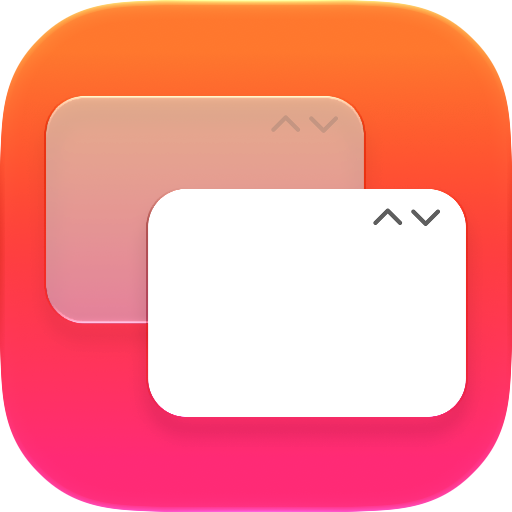

<p align="center">
  
</p>

<h1 align="center">Tuxedo</h1>

<p align="center">Debian Linux on your iPhone and iPad. Tuxedo (formerly Henge).</p>

<p align="center">
  <a href="#install">Install</a>
  ·
  <a href="#linux-machines">Linux machines</a>
  ·
  <a href="docs/architecture.md">How it works</a>
  ·
  <a href="https://itslevii.dev">Website</a>
  ·
  <a href="https://github.com/Leviidev/Henge/releases">Releases</a>
</p>

<p align="center">
  <a href="https://github.com/Leviidev/Henge/releases"></a>
  <a href="LICENSE"></a>
</p>

Tuxedo is an arm64 JIT emulator. It runs a Debian Linux guest on an iPhone or iPad. Download an image, start the machine, and use it. macOS guest support was removed on 14/11/2026.

- **Own emulator** — iOS gives apps no hypervisor, so Tuxedo runs the guest's arm64 code through its own JIT, with its own MMU and devices. It doesn't use QEMU or Virtualization.framework.
- **Debian 13** — Debian (arm64) boots through U-Boot on a virtual machine that follows QEMU's `virt` board. A text console, or a desktop with labwc (Wayland).
- **Accelerated graphics** — Opt-in. Tuxedo replays the guest's virgl 3D commands with ANGLE on Metal, with OpenGL ES 3.0.
- **Video decode and encode** — Opt-in. The guest decodes H.264, VP9 and AV1 (VA-API) and encodes with `ffmpeg` on the device's VideoToolbox.
- **Files folders** — Folders from the Files app appear in the guest at `/media/tux/<name>`. A shared folder and a shared clipboard (desktop image) are there too.
- **Port forwards** — Another device on the local network can reach a TCP port in the guest, for example SSH, through a port on the phone.
- **Touch and trackpad** — The screen is a Magic Trackpad 2 to the guest. The volume buttons can click. A hardware keyboard and a mouse or trackpad also work on iPad.
- **External display** — Connect a display with a video-capable USB-C cable or a USB-C/HDMI dock. The guest moves to the monitor, up to 4K, and the device keeps its trackpad and keyboard controls.
- **Fits the screen** — The screen follows the phone's size and rotation.

## Install

Sideload `Henge.ipa` from [Releases](https://github.com/Leviidev/Henge/releases) with SideStore or AltStore, or install `Henge.tipa` with TrollStore or TrollStore Lite. To get updates in SideStore or AltStore, add Henge's source, `https://raw.githubusercontent.com/Leviidev/Henge/main/repo.json`, or `https://itslevii.dev/repo.json` for all of Leviidev's apps. iOS or iPadOS 17 or later, on an A14 or M1 chip or newer. So far it's tested only on an iPhone 17 Pro and in the iOS Simulator: iPad support hasn't run on a real iPad yet.

- **JIT** is required: StikDebug, TrollStore (which stops at iOS 17.0), TrollStore Lite (which needs a jailbreak), a jailbreak on its own, or the StikJIT helper built into Tuxedo (iOS 26 or later).
- **Storage:** a Linux image downloads at about 0.2 GB (console) or 0.3 GB (desktop). The disk grows to the size you pick (16 GB by default).
- **Memory:** sign Tuxedo with the increased memory limit entitlement if your certificate has it.

## Linux machines

A machine runs Debian 13 (trixie) for arm64, minimal. Tuxedo starts it with U-Boot, on a virtual board that copies QEMU's `virt` machine, and it runs on the same JIT engine. There are two images:

- **Console**: a text terminal on the serial port. About 0.2 GB to download.
- **Desktop**: labwc (Wayland) and one terminal, with the screen, pointer and keyboard. About 0.3 GB to download.

Both are 16 KB-page Debian kernels (`linux-image-arm64-16k`). The disk is 3 GB inside the image and grows to the size you pick at install (16 GB by default). The user is `tux`, who logs in by itself and has passwordless `sudo`. There is no SSH server.

### Get an image

There is no default image host yet, so one of these:

- **A catalogue.** Open Settings, paste the address of a `linux-images.json` under Linux images, then open Install and choose Linux. Tuxedo downloads the firmware and the disk, checks both, and makes the machine. A catalogue on a public host must use `https`. Plain `http` works only to a local address. `tools/linux/package-image.sh` makes a catalogue and `tools/linux/serve.sh` serves it on the LAN.
- **A folder.** `tools/linux/export-ios.sh DISK FIRMWARE [NAME] [RAM_MB]` makes a folder with `machine.json`, `u-boot.bin` and `disk.img.hvsparse`. Drop it on Tuxedo in Finder or pick it in Files.

[tools/linux/README.md](tools/linux/README.md) builds the firmware and the images from nothing.

### What works

The Mac tool (`build/tuxvm`) runs all of this under `make test-linux-*`. The app was run in the iOS Simulator. Nothing in this list has had its iPhone check yet.

- Boot through U-Boot to a login in about 5 to 7 s on the Mac tool at one CPU, restart, power off, and a power key (Shut Down in the app, `SIGTERM` or Ctrl-A p in `tuxvm`). In the simulator the console prompt took about 12 s.
- 1 to 4 CPUs, virtio disk (with discard), network (user-mode NAT, `10.0.2.15`), entropy, USB keyboard and Magic Trackpad 2, sound, and the memory balloon device (off by default and not driven by the app).
- A screen that follows the phone's size and rotation, or an external display up to 4K, a shared folder at `~/Tux` and a shared clipboard (desktop image).
- Graphics acceleration, off by default: virgl on ANGLE and Metal, with OpenGL ES 3.0. It takes more memory on the phone, and a graphics fault can stop the machine.

### Known limits

- The guest kernel must use 16 KB or 64 KB pages. A 4 KB distribution kernel does not run.
- The iPhone checklist ([docs/iphone-checklist.md](docs/iphone-checklist.md)) is not done: JIT, the download over Wi-Fi, the shared folder, sound, the external display, acceleration and the memory figures are all unchecked on a device.
- The iPad layout and a hardware keyboard and mouse have not been tried with Linux.
- Debuggers in the guest cannot single-step or set hardware breakpoints. There are no performance counters, and no KVM inside the guest.
- 3D stops at OpenGL ES 3.0. There is no Vulkan.
- If the app is suspended while the guest runs, Linux can report an RCU stall when it resumes.
- Without a shared folder, the first visit to `~/Tux` takes about 12 s.
- One machine runs at a time.

## Building

To use Henge, install the [latest release](https://github.com/Leviidev/Henge/releases). Every change lands on `main` as it's made, so `main` can be unfinished between releases.

On a Mac with Xcode 27 or later and `xcodegen`. Henge takes StikJIT, on-device pairing, libslirp and glib from a built [Husk](https://github.com/Leviidev/Husk) checkout at `~/Documents/Coding/Husk` (set `HUSK` to use another path):

```bash
ios/scripts/fetch_deps.sh
make ios-lib
ios/scripts/package_ipa.sh
```

That produces `~/Desktop/Tuxedo.ipa`, and `package_ipa.sh --trollstore` writes `Tuxedo.tipa`.

`make` builds the engine for the Mac, `build/tuxvm`, and `make test` runs its tests. `make test-linux-smoke` boots Debian on it, after `tools/linux` has built the firmware and an image. Graphics acceleration needs the libraries from `tools/gfx/build-deps.sh` and `make GFX=1`.

## Licence

GPL-2.0-or-later. Tuxedo compiles in code from Husk (GPL-2.0-or-later), so the shipped binary is a combined GPL work. It cannot go on the App Store. See [docs/licensing.md](docs/licensing.md).

A Linux image holds Debian packages and, next to it, a U-Boot binary. U-Boot is GPL-2.0, mostly or later, and Debian's packages have their own licences. [docs/licensing.md](docs/licensing.md) says where their source comes from.
