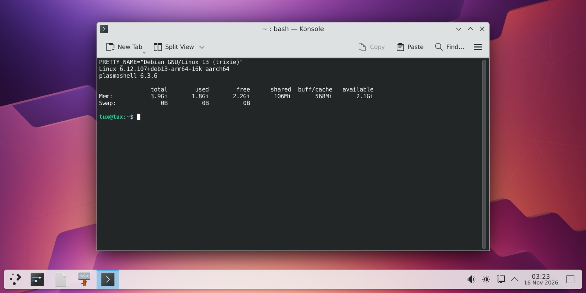
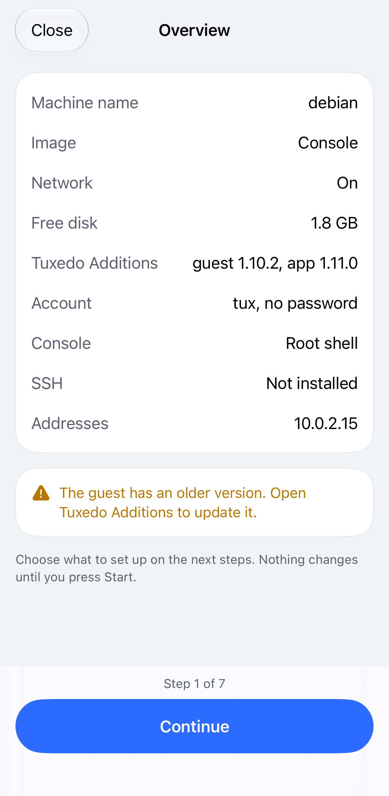
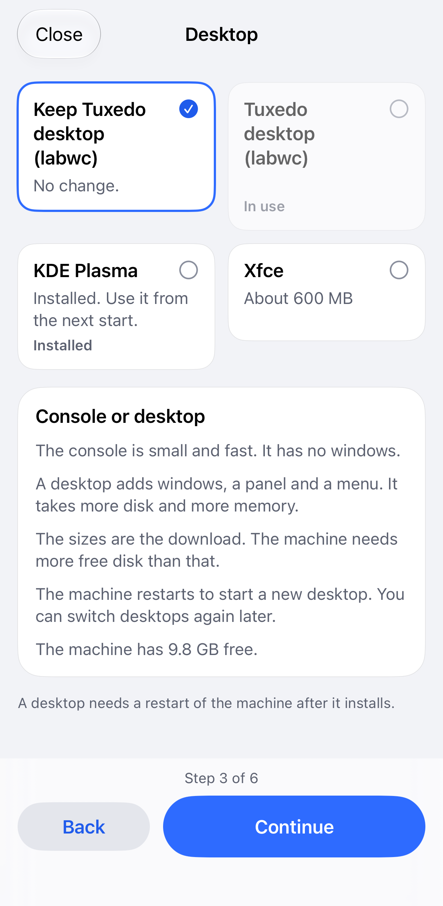
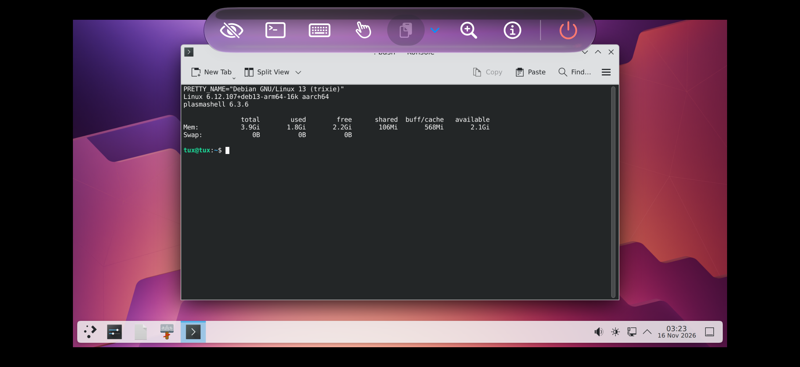
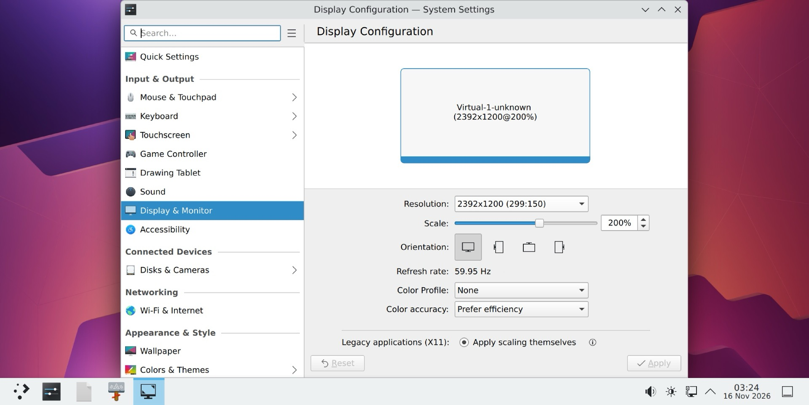
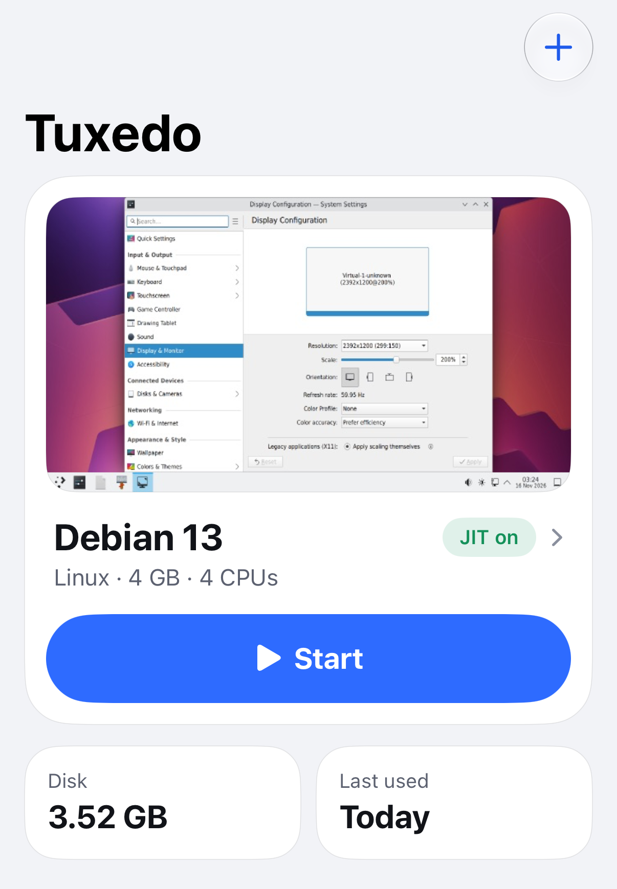

<p align="center">
  
</p>

<h1 align="center">Tuxedo</h1>

<p align="center">Debian, with a desktop, on an iPhone or iPad.</p>

<p align="center">
  
</p>

<p align="center"><sub>KDE Plasma 6.3 on Debian 13, running in Tuxedo in the iOS Simulator.</sub></p>

Tuxedo boots a whole arm64 machine inside an iOS app. U-Boot starts Debian's own kernel, systemd comes up, and from there it is ordinary Debian with `apt`, `sudo` and a desktop if you want one. iOS gives apps no hypervisor, so Tuxedo translates the guest's code with its own JIT and emulates the MMU, the interrupt controller and every device itself. There is no QEMU underneath.

It is a fork of [Henge](https://github.com/Leviidev/Henge) by Leviidev, which does the same trick for macOS guests on an iPad. The translator, the JIT set-up and the on-screen trackpad are Henge's. Tuxedo took the macOS guest out and put a Linux machine in its place.

## What Tuxedo adds to Henge

### The machine

The virtual board copies the layout of QEMU's `virt` machine, with a GICv3, a PL011 serial port, an xHCI controller for the keyboard and trackpad, and virtio devices on PCIe for disk, network, sound, GPU and shared folders. U-Boot v2026.10 reads `extlinux.conf` from the disk and starts the kernel. That kernel has to be a 16 KB-page build, which is why the images use Debian's `linux-image-arm64-16k` (6.12).

A machine has 1 to 6 CPUs and 1 to 16 GB of memory. The network is user-mode NAT through libslirp, so the guest sits at `10.0.2.15` and reaches the internet through whatever the phone is on. On a Mac, where the same engine builds as a command-line tool, one CPU gets from power-on to a login prompt in about five seconds.

### A setup wizard

<p align="center">
  
  &nbsp;&nbsp;
  
</p>

A fresh image is a bare Debian with a `tux` user and no password. "Insert Tuxedo Additions CD" in a machine's Details works like VirtualBox's Guest Additions disc. A read-only folder appears in the guest, and a wizard opens in the app. It asks for an account (name, password, sudo, automatic sign-in), a desktop, applications from a list of 23, and whether you want an SSH server. Nothing happens until you press Start on the Review page. Then an agent in the guest does the work as root while the app shows each step.

The agent cannot be told to run a command. A job is a list of action names from the media's `actions.json`, each with parameters the agent checks, and the guest verifies the media's signature against a key it already holds before it starts the agent at all. Your password goes to `chpasswd` once and is not stored or logged.

The media travels inside the app (about 40 MB) as a signed apt repository with Tuxedo's four guest packages and the Debian packages a minimal image lacks. So the account, Additions and SSH steps work with no network. Desktops and applications come from Debian's mirrors.

There are three desktops. The Tuxedo desktop is labwc with a terminal, and the other two are KDE Plasma on Wayland and Xfce on Xorg. None of them uses a display manager. The tty1 login runs `tux-session`, which starts whichever desktop `/etc/tux/session` names, so changing to a desktop that is already installed costs one restart and no download.

### OpenGL ES 3.0

Graphics acceleration is a switch in each machine's settings, off by default. With it on, Mesa's virgl driver in the guest sends its commands over virtio-gpu, and Tuxedo replays them with virglrenderer on ANGLE, which turns them into Metal. KWin, Firefox and anything else that asks EGL for a context gets OpenGL ES 3.0. On the Mac build, glmark2 at 1280x720 scores 229 this way and 16 on llvmpipe.

ANGLE's Metal backend stops at ES 3.0, so there is no ES 3.1, no OpenGL core profile and no Vulkan. iOS also allows no Metal work in the background, so an accelerated machine pauses whenever you leave the app.

### Hardware video

"Video decode" is a second switch under graphics acceleration. Mesa's VA-API driver for virgl hands compressed frames to the host, where a VideoToolbox back end added to virglrenderer decodes them and passes the planes to the GPU as IOSurfaces. On an iPhone 18 Pro, `vainfo` lists H.264 Main and High, VP9 profiles 0 and 2, and AV1 profile 0. HEVC is not offered.

These are 1080p30 clips of 450 frames, decoded with `ffmpeg -hwaccel vaapi` in a 3-CPU guest on that phone. Every frame matched the software decoder's output.

| Codec | VA-API | Software | Guest CPU, VA-API | Guest CPU, software |
| --- | --- | --- | --- | --- |
| H.264 | 348 fps | 284 fps | 0.40 s | 4.0 s |
| VP9 | 329 fps | 537 fps | 0.39 s | 1.7 s |
| AV1 | 255 fps | 348 fps | 0.33 s | 2.5 s |

Software is quicker for VP9 and AV1 on clips this simple. What the hardware path saves is the CPU time in the last two columns.

Firefox needed one more piece, and fell back to software decoding without it. The `tux-va` package wraps Mesa's driver so that NV12 is the only 8-bit format on offer, and with it Firefox 160 plays all three codecs from hardware frames.

Encoding goes another way. `tux-ffmpeg` is FFmpeg 9.0.2 with two extra encoders, `h264_tux` and `hevc_tux`, which reach VideoToolbox through a small service on the host. A 4K60 HEVC transcode ran at 69.7 frames a second on the phone. There is no AV1 encoder.

### Passwords in the iOS Keychain

In the guest, `tux-secrets` takes the place of both kwalletd and gnome-keyring. It answers on `org.kde.kwalletd6` and on `org.freedesktop.secrets`, so KDE programs, plasma-nm, Chromium and anything built on libsecret work unchanged. The items themselves are stored in the iOS Keychain, in an entry for that one machine that never leaves the device. The guest has no wallet file and no wallet password.

Tuxedo asks for Face ID, or the passcode, before a machine's screen appears. It asks once each time the app is launched, and the wallet stays open for the session. While it is open, any program running as your user in the guest can read it. `tux-secrets --import` copies an existing `.kwl` wallet across.

### SSH

The images ship without an SSH server. The wizard's SSH step installs `openssh-server` from the media, sets the port and whether passwords are accepted, adds your public key and shows you the host key fingerprints. Root login stays off.

The guest is behind NAT, so reaching it from another computer takes a port forward. "Add SSH (2222 → 22)" in Details makes one, and Details then shows the command to copy.

```bash
ssh -p 2222 you@192.168.1.23
```

A machine can have 16 forwards. Phone ports start at 1024 because iOS binds nothing lower. They listen on Wi-Fi, Ethernet, Personal Hotspot and VPN interfaces, and never on cellular.

### Pointer lock on an iPhone

iPadOS lets a full-screen app lock the pointer, so that a mouse moves the guest's pointer and nothing else. Henge used that, and Tuxedo still does on an iPad. On an iPhone the same request does nothing. The iPhone's own pointer stays on screen above the guest's, and a click near the bottom edge lands on the Home bar and closes the app.

The reason is one function in UIKit, `_UIPointerLockStateIsAvailableForScene`, which returns false unless the device is an iPad or a Mac. Because of it an iPhone scene never gets a pointer lock state, and the request is never sent. The system side has no such test. Tuxedo replaces the getter for `UIScene.pointerLockState` with one that leaves the test out, and writes the preference into the scene's client settings itself.

In the iOS 27.0 simulator an iPhone gets the lock, loses it in the background and gets it back. Nobody has confirmed it on a phone yet. It is private API and could break with any iOS update, so it has a switch (Settings, Mouse, "Capture an external mouse"). [docs/mouse-capture-ios.md](docs/mouse-capture-ios.md) has the disassembly.

### Input

<p align="center">
  
</p>

The phone's screen is the guest's trackpad. Tuxedo plugs a virtual Apple Magic Trackpad 2 into the guest's USB bus, and Linux's own driver does the two-finger scrolling and the gestures. That emulation and the option to click with the volume buttons both came from Henge's community forks.

Tuxedo adds a direct touchscreen mode behind the hand button, for desktops with finger-sized targets. The on-screen keyboard also comes up by itself when a Linux program focuses a text field, and Plasma keeps its windows above it. The bar in the screenshot holds the session controls. You can hide it, and a four-finger tap brings it back.

### Screens

<p align="center">
  
</p>

The guest's display takes the phone's own size, which is 2392 x 1200 at 200% on an iPhone 18 Pro held sideways. Plug in a monitor over USB-C or an HDMI dock and the guest moves to it, at up to 4K, while the phone turns into a trackpad with the session controls. Settings in the app shows what the monitor reports and the mode Linux ended up with.

### Files

Folders you pick in the Files app are mounted in the guest under `/media/tux/` over virtio-fs. Each one is read-write, read-only or copy-on-write. A copy-on-write folder keeps the guest's changes in an overlay until you export or discard them. There is also a fixed shared folder at `~/Tux`, and the desktop image shares the clipboard for text.

### Battery, brightness and clock

The phone's battery and charger show up in the guest as a smart battery, and its brightness as a backlight, so Plasma's battery icon and brightness slider work the way they do on a laptop. Volume, the clock and the time zone follow the phone as well.

## Performance

Geekbench 7 in the guest on an iPhone 18 Pro (A20 Pro) scores [1402 single-core and 3069 multi-core](https://browser.geekbench.com/v7/cpu/871052).

## What you need

- An iPhone or iPad with an A14 or M1 or later, on iOS or iPadOS 17 or later.
- JIT. From iOS 26 an app gets executable memory only while a debugger is attached, so in practice that means StikDebug or the StikJIT helper built into Tuxedo. On iOS 17.0, TrollStore works too, and so does a jailbreak.
- Room for a disk. The desktop image is a 352 MB download and the console image 239 MB. The disk then grows as the guest fills it, up to the size you choose (16 GB unless you change it).

## Building it

<p align="center">
  
</p>

There is no download. Tuxedo is GPL and includes GPL code from Husk, which keeps it off the App Store, so you build the IPA on a Mac and sideload it. You need Xcode 27, `xcodegen` and a built [Husk](https://github.com/Leviidev/Husk) checkout at `~/Documents/Coding/Husk` (or point `HUSK` at yours).

```bash
ios/scripts/fetch_deps.sh
make ios-lib
make linux-additions
ios/scripts/package_ipa.sh
```

That leaves an ad-hoc signed `Tuxedo.ipa` on the Desktop for SideStore or AltStore to sign again with your certificate. `package_ipa.sh --trollstore` writes a `.tipa`.

`make linux-additions` builds the wizard's media and needs Docker. If you skip it the app still builds, and the wizard has nothing to install from. Graphics acceleration is linked in only if `tools/gfx/build-deps.sh` has run first, which fetches 8 to 9 GB of ANGLE and virglrenderer sources and takes 30 to 60 minutes. [ios/README.md](ios/README.md) goes through the signing options.

## Your first machine

1. In Settings, under Linux images, paste a catalogue address. The project's own catalogue is at `https://walkies.site/tux-linux-catalogue/linux-images.json`.
2. Open Install, pick the console or the desktop image, and choose a disk size and memory.
3. Start the machine, open Details and choose "Insert Tuxedo Additions CD".
4. Go through the wizard and press Start on the Review page.

If you would sooner make your own image, [tools/linux/README.md](tools/linux/README.md) builds the firmware and both images from nothing.

## On a Mac

`make` builds the engine as `build/tuxvm`, a command-line tool that boots the same images.

```bash
build/tuxvm --firmware build/linux/u-boot.bin --disk debian.img --ram 2048 --cpus 2
```

`make test` runs the engine's unit tests. Around 40 `make test-linux-*` targets each boot a real guest and check one thing, such as `test-linux-accel` for the GPU path, `test-linux-video` for decode and `test-linux-forward` for SSH through a port forward.

## Where it stands

Tuxedo is developed and used on one iPhone 18 Pro with iOS 27.3. It has never run on an iPad.

- The kernel must use 16 KB or 64 KB pages. A distribution's 4 KB kernel will not boot.
- One machine runs at a time.
- The guest has no KVM and no performance counters, and a debugger inside it cannot single-step.
- VA-API cannot decode HEVC, and AV1 film grain fails in hardware (`mpv --hwdec=no` gets round it).
- If iOS suspends the app while a machine runs, Linux can log an RCU stall when it comes back.

[docs/architecture.md](docs/architecture.md) explains how the engine and the board work, and [CHANGELOG.md](CHANGELOG.md) has the history.

## Licence

GPL-2.0-or-later. [docs/licensing.md](docs/licensing.md) lists the third-party code in the app and the licences that come with a Linux image.

## Credits

Tuxedo is built on [Henge](https://github.com/Leviidev/Henge) by Leviidev and on fixes from the forks of [hungbenjamin402](https://github.com/hungbenjamin402/Henge), [sonnx0868](https://github.com/sonnx0868/Henge), [gavinnolan](https://github.com/gavinnolan/Henge), [AdamLovattDevOps](https://github.com/AdamLovattDevOps/Henge) and [braedonsaunders](https://github.com/braedonsaunders/Henge). It uses [Husk](https://github.com/Leviidev/Husk), StikJIT, idevice, UTM's forks of libepoxy and virglrenderer, ANGLE and SwiftTerm.
