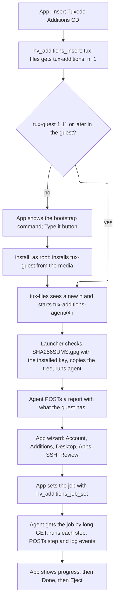

# Tuxedo Additions: the design that is built

Status: contract for the build, 15/11/2026. It changes `docs/guest-additions-plan.md` where the two differ. This file wins.

## 1. What changed from the plan

1. **The wizard is in the app.** The owner chose a touch wizard on the phone (SwiftUI), not a text menu in the guest. The guest has no GUI toolkit, and the wizard must also work on the console image and before any desktop exists. The app sends choices. A guest **agent** does the work and reports back.
2. **There is autorun.** "Insert Tuxedo Additions CD" in the app starts the agent in the guest by a signal. The agent runs as root, but only after the guest checks the media signature with the key it already has. The plan said "no autorun". The owner asked for it.
3. **Root by default.** The agent is a systemd service, so it runs as root. It does not need the `tux` account or `sudo`. The bootstrap `install` script puts itself in root with `sudo` when it is not root.
4. **The account is part of the wizard.** The images have a `tux` account with an empty password. The wizard can set a password, or create the account when it does not exist. It shows and offers **automatic sign-in** and **sudo**.
4a. **The console signs in as root until the account is set up.** `tux-guest` 1.11.0 ships the root auto-login for the serial console (`ttyAMA0`, the console the app shows) and for `tty1` on a guest with no desktop. A fresh machine has no account marker, so its console is a root shell. When the guest says it has no configured account, the app opens the wizard by itself (it inserts the media, then shows the wizard at the Account step). After the Account step runs, the root auto-login ends and the console follows the choices in the wizard. The desktop image keeps its own `tty1` auto-login for the desktop user.
5. Decisions on the plan's questions: Q1 yes (the virtio-fs device is on for every Linux machine). Q2 a folder, not a real CD (the app still calls it a CD). Q3 bundle the media in the app. Q4 yes (licensing text changes). Q5 Tuxedo-layout guests are supported, other trixie guests are best effort. Q6 refuse legacy `henge-*`. Q7 no notification server. Q8 yes, include `tux-ffmpeg`.

## 2. The flow



## 3. Names

| Thing | Value |
|---|---|
| Reserved folder name | `tux-additions` |
| Reserved index | `HV_FS_ADDITIONS` = `HV_FS_MAX_FOLDERS` (8). The table has 9 entries. User folders stay at 8. |
| Guest mount | `/media/tux/tux-additions` (Read-only, from `tux-files`) |
| Media in the app | `Tuxedo.app/TuxAdditions/` (a copy of `build/linux/additions/tux-additions/`) |
| Link | `GET` and `POST` `http://10.0.2.4/.tux/additions` |
| Guest state | `/var/lib/tux/additions/` (copy of the verified media, `current` link), `/var/lib/tux/additions.json` (last report), `/var/lib/tux/account.json` (the account marker) |
| Units | `tux-additions-agent@.service` (template, instance = n) |
| Key | `/usr/share/keyrings/tux-archive.gpg` (the installed key is the only trust anchor for autorun) |

## 4. The media (`tux-additions/`)

```
install            POSIX sh. The bootstrap. Root (or it runs sudo). Installs tux-guest, tux-va, tux-ffmpeg from apt/. Exit codes 0,1,2,3,4 (plan 3.3).
agent              python3 (stdlib only). The agent. `agent run --n N`. Runs as root.
actions.json       The catalogue. protocol, desktops, apps, ssh limits, package lists. The agent runs only what this file names.
versions.json      additions version, protocol, package versions, built date
README.txt         What this is, the commands, licences, source offer
SHA256SUMS         Every other file except itself and its .gpg
SHA256SUMS.gpg     Detached signature by the Tuxedo archive key
tux-archive.gpg    The public key (same bytes as in tux-guest)
apt/               A signed apt repository: main (the four Tuxedo debs), deps (Debian debs a minbase guest lacks, plus openssh-server and its closure)
source/SOURCES.txt
```

Verify (the launcher and `install` both do this): `gpgv --keyring <key> SHA256SUMS.gpg SHA256SUMS && sha256sum -c --strict SHA256SUMS`.

`actions.json` shape (the agent and the app both read it; the app reads its bundled copy for sizes and labels):

```json
{
  "protocol": 1,
  "desktops": [{"id":"labwc","title":"Tuxedo desktop (labwc)","packages":["labwc","foot","..."],"size_mb":150,"files":"desktop-labwc"},
               {"id":"plasma","title":"KDE Plasma","packages":["kde-plasma-desktop","sddm"],"size_mb":1500},
               {"id":"xfce","title":"Xfce","packages":["xfce4","lightdm"],"size_mb":600}],
  "apps": [{"id":"firefox","title":"Firefox","group":"web","packages":["firefox-esr"],"size_mb":80}, "..."],
  "ssh": {"port_min":1,"port_max":65535,"default_port":22}
}
```

Groups for apps: `web`, `office`, `media`, `graphics`, `develop`, `tools`. The catalogue must hold at least: Firefox, Chromium, LibreOffice, Thunderbird, VLC, mpv, GIMP, Inkscape, Kate, git, build-essential, python3-pip, htop, curl, tmux, neovim. A package name that does not exist in trixie arm64 is a bug the builder test must catch (it checks against the Packages index of the pinned snapshot when it has network, else it skips with a message).

## 5. The wire contract (guest and host)

All bodies are UTF-8 JSON objects. The host never runs anything it reads.

### 5.1 `.tux-folders`

The reserved entry is in the table like any entry, with two extra fields: `"kind":"additions"` and `"n":N` (N starts at 1 on the first insert and goes up by one on every insert and every nudge). A guest with an older `tux-files` ignores the fields and mounts a plain Read-only folder.

### 5.2 `GET /.tux/additions[?since=S]` (guest)

Long poll, up to 120 s, the same way as `/.tux/folders`. Header `X-Tux-Seq: S`. Body:

```json
{"inserted":true,"n":3,"cancel":false,"cancel_job":null,"job":null,"taken":null}
```

- `job` is the object the app set, until the agent takes it. After the agent posts `ack` for it, `job` is `null` and `taken` is that job's id. The job (and its password) is served only until then, so it crosses the link once.
- `cancel_job` is the id of the job the app cancelled last, or `null`. `cancel` is `true` when `cancel_job` is not `null`. The agent cancels only when `cancel_job` equals the id of its own job, so a new job is not cancelled by an old Cancel.
- Not inserted: `{"inserted":false,"n":0,"cancel":false,"cancel_job":null,"job":null,"taken":null}`.

### 5.3 `POST /.tux/additions` (guest), 64 KB at most

One event per request. The host answers `200 {"seq":S}`, `400` if the body is not a JSON object with a string `t`, `413` if too big. Event types:

| `t` | Fields | Meaning |
|---|---|---|
| `report` | `n`, `agent` (version string), `protocol` (int), `caps` (object, 5.4) | What the guest has. Sent when the agent starts, after each step list, and by `tux-status` on boot and after dpkg. |
| `ack` | `job` (string) | The agent has the job. Posted before the first step. The host wipes the stored job when `job` equals its id. |
| `step` | `job` (string), `i` (int, index in the job's steps), `status` (`running`,`ok`,`failed`,`skipped`), `msg` (string, one line) | Progress. |
| `log` | `job`, `text` (a chunk of output, 4 KB at most) | Output for the app's log view. The agent never writes a password into it. |
| `done` | `job`, `ok` (bool), `reboot` (bool), `info` (object: `ips`, `ssh_fingerprints`, `user`) | The job ended. The host wipes the job from memory when `job` equals the id of the stored or taken job, and forgets the taken id. A `done` for another id changes nothing on the host. |
| `bad-media` | `n`, `why` (string) | The launcher refused the media (bad signature or sums). |

### 5.4 `caps` in a `report`

```json
{"installed":{"tux-guest":"1.11.0","tux-va":"1.0.1","tux-ffmpeg":"9.0.2-tux2","tux-codec-dkms":null},
 "legacy":false,
 "account":{"name":"tux","uid":1000,"exists":true,"password_set":false,"configured":false,"sudo":true,"autologin":"root"},
 "root":true,
 "network":false,
 "desktop":"none",
 "ssh":{"installed":false,"enabled":false,"port":22,"password_auth":true},
 "apps":{"firefox":false,"git":true},
 "hostname":"debian",
 "disk_free_mb":1800,
 "image":"console",
 "ips":["10.0.2.15"],
 "kernel":"6.12.x-arm64-16k"}
```

`account.configured` is true when the marker `/var/lib/tux/account.json` exists. `account.autologin` is who the console signs in as without a password: `root`, `user` (the account) or `none` (a login prompt). A guest whose uid-1000 user already has a password when `tux-guest` 1.11.0 is installed counts as configured (the package writes the marker and the masking files then, and leaves the console as it was). `network` is true when the agent can open a TCP connection to the apt mirror in `/etc/apt/sources.list*` within 3 s. `image` is `desktop` when `labwc`, `plasma-workspace` or `xfce4-session` is installed, else `console`. `desktop` is the one that is installed: `labwc`, `plasma`, `xfce` or `none`.

### 5.5 The job (app to guest)

Set with `hv_additions_job_set(json)`. 16 KB at most. It needs a string `id` (1 to 64 characters of `A-Za-z0-9_-`), or the call fails with `EINVAL`. A new job replaces a stored job that the agent has not taken. Eject, cancel before the agent takes the job, a replacing job and `hv_additions_job_clear` all overwrite the stored bytes with zero. Shape:

```json
{"id":"j-8f3a","steps":[
  {"action":"additions.install"},
  {"action":"user.setup","name":"tux","password":"secret","sudo":true,"autologin":true,"lock_root":true},
  {"action":"hostname.set","name":"tuxbox"},
  {"action":"desktop.install","id":"labwc"},
  {"action":"apps.install","ids":["firefox","git"]},
  {"action":"ssh.configure","enabled":true,"port":22,"password_auth":false,"root_login":false,"authorized_key":"ssh-ed25519 AAAA... me@phone"},
  {"action":"system.update"}
]}
```

The agent posts `ack`, then runs the steps in order. While it runs a job it holds the file `/run/tux/additions-busy` (JSON with its pid and the job id) and removes it at the end. `tux-files` does not stop or restart the agent for a new `n` while that file names a live pid; it starts the new agent when the job ends. It stops at the first `failed` step and marks the rest `skipped`. It checks `cancel` between steps and between apt calls. Rules:

- The agent takes ids from the catalogue only. An id that is not in `actions.json` makes the step `failed` with "unknown id". No step takes a command line.
- Every external program runs with an argument list (never `shell=True`). Values are checked first: user and host names with `^[a-z_][a-z0-9_-]{0,31}$` and `^[a-z0-9]([a-z0-9-]{0,61}[a-z0-9])?$`, the port with 1 to 65535, the key with a type in `ssh-ed25519`, `ecdsa-sha2-nistp256/384/521`, `ssh-rsa`, `sk-ssh-ed25519@openssh.com` and a base64 body on one line (no newline, 4 KB at most).
- A password goes to `chpasswd` on standard input. It is never in an argument list, a log line or `/var/lib/tux/additions.json`. The agent drops its copy after use.
- Steps that need the network (`desktop.install`, `apps.install`, `system.update`) end `failed` with "No network" when `caps.network` is false. They do not wait.
- `additions.install`: runs the same code as `install` (apt from the local `file:` source). Idempotent.
- `user.setup`: creates the user when missing (uid 1000 when free, home, `bash`, groups `audio,video` and `sudo` when `sudo` is true; with `sudo` false it removes the user from `sudo` and keeps `/etc/sudoers.d/tux` only if it exists for another reason, the agent never deletes a file it did not write). It sets the password when given. The name defaults to the existing uid-1000 user. A name other than `tux` works for the account, but the `~/Tux` mount of `tux-guest` still uses `/home/tux`, so the agent says so in the step message. Then it writes the marker `/var/lib/tux/account.json` (`{"configured":true,"name":...,"autologin":bool,"sudo":bool}`, no password) and sets the console login:
  - `autologin` true: the console signs in as the account without a password (serial `ttyAMA0`, and `tty1` on a guest with no desktop).
  - `autologin` false: the console shows a login prompt.
  - Either way the root auto-login ends. `lock_root` true (the default) also runs `passwd -l root`, so root cannot sign in at the console. The wizard shows this as "Root sign-in ends" and lets the user turn it off. A user who chooses no password and no auto-login gets a login prompt where the account accepts an empty password, as the images do today; the wizard warns.
  - The mechanism is in section 6 (`tux-console-login`).
  - Order: set the password, write the marker, then lock root, then restart the getty after `done`. If the marker write fails, root stays unlocked.
  - Refused (the step fails and changes nothing): a name that exists with a uid other than 1000 or with a shell of `nologin` or `false` (so `root`, `daemon`, `sshd` and the like fail), and `lock_root` true with `sudo` false (nobody could become root). With `lock_root` false and `sudo` false the console still works.
  - When the account is not `tux` and the stock `tux` account still has an empty password, the agent locks that password (`passwd -l tux`) and moves the stock sudo file aside, and says so in the step message.
- `hostname.set`: `hostnamectl set-hostname`, and fixes `/etc/hosts` for the new name.
- `desktop.install`: `apt-get install -y --no-install-recommends <packages>` from the catalogue. For `labwc` it also installs the Tuxedo session files from the media (`desktop-labwc/`, copied from `tools/linux/rootfs-desktop`) and enables a console login on tty1 as the account only when the marker says `autologin` is true (else the desktop starts at a login prompt). Marks `reboot: true`.
- `apps.install`: one apt call for all packages of the chosen ids.
- `ssh.configure`: installs `openssh-server` from the local repository when missing (it works with no network). Installs `openssh-server` with a temporary `/usr/sbin/policy-rc.d` that refuses to start services (removed after), so sshd never runs with Debian's defaults. On any later failure it stops and disables the `ssh` service when this step installed it. Writes `/etc/ssh/sshd_config.d/10-tux.conf` (Port, PasswordAuthentication, PermitRootLogin, KbdInteractiveAuthentication), checks it with `sshd -t`, restores the old file when the check fails, then enables and starts or stops `ssh.service` as asked. Adds `authorized_key` to the account's `~/.ssh/authorized_keys` with mode 600 (once only). The `done` event carries the host key fingerprints (`ssh-keygen -lf`).
- `system.update`: `apt-get update`, then `apt-get -y upgrade`.

### 5.6 The app's view

`hv_additions_events_json(since, &seq)` returns:

```json
{"inserted":true,"n":3,"seq":42,"gap":false,"events":[{"k":40,"e":{"t":"report", ...}},{"k":41,"e":{"t":"step", ...}}]}
```

`k` goes up by one per event. The host keeps the last 512 events or 512 KB. `gap` is true when `since` is older than the oldest kept event (the app then shows the last report it has and asks for a new one with a nudge). `hv_additions_wait(since, ms)` blocks until the sequence passes `since` or the time ends.

## 6. The guest side

- **`tux-files`** (in `tux-guest`): when the table has an entry with `kind` = `additions` and its `n` is not the `additions_n` kept in `/run/tux/files.json`, it saves the new `n` and runs `systemctl stop 'tux-additions-agent@*'; systemctl start --no-block tux-additions-agent@<n>.service`. It does this after it mounts the entry. If the entry goes away, it stops the agent when no job runs. A restart of `tux-files` does not start the agent again for the same `n`.
- **`tux-additions-launch`** (in `tux-guest`, root): verifies the media at `/media/tux/tux-additions` with the installed key only, copies the tree to `/var/lib/tux/additions/<n>.new`, renames it to `<n>`, points `current` at it, deletes older trees, then `exec`s `python3 /var/lib/tux/additions/current/agent run --n <n>`. On a bad signature it POSTs `bad-media` and exits 4. The installed launcher is small and stable. The agent in the media can change with each release.
- **`agent run`**: refuses a `protocol` it does not know. POSTs a `report`. Long-polls the link. Runs a job when `job.id` is new. Exits when the media is ejected and no job is running, or after 60 min with no job. Output of `apt` and others goes to `log` events, 4 KB per event.
- **`tux-additions-report`** (in `tux-guest`): a small python3 script that builds `caps` the same way as the agent (the agent imports the same code from the media, and a copy of the script lives in `tux-guest` for boot and dpkg reports). `tux-status` runs it at start. `/etc/apt/apt.conf.d/50tux-additions` runs it in `DPkg::Post-Invoke`. A failure to post is only logged.
- **The console login** (in `tux-guest`): vendor drop-ins `usr/lib/systemd/system/serial-getty@ttyAMA0.service.d/tux-login.conf` and `getty@tty1.service.d/tux-login.conf` clear `ExecStart=` and run `/usr/lib/tux/tux-console-login %I`. That script chooses and then `exec`s `agetty`: no marker means `--autologin root` (but for `tty1` it first checks for `/usr/bin/labwc`, `plasma-workspace` or `xfce4-session`; when a desktop is installed it runs the stock `agetty` command with no autologin and leaves the image's own `tty1` drop-in in charge); a marker with `autologin` true means `--autologin <name>`; a marker with `autologin` false means a plain login prompt. Because the wrapper reads the marker at each start, the agent changes the login by writing the marker only (no unit edits), and the change applies at the next console login or restart of the getty (the agent restarts `serial-getty@ttyAMA0` at the end of the step, after the `done` event is posted, so the app's console shows the new state). The desktop image's own `tty1` drop-in in `/etc` must still work: check the lexical order of drop-ins and make the result correct (the stock `getty@tty1` of the desktop image must still sign in as its desktop user). The wrapper must not give `agetty` the `-o` option (`--login-options`): with `-o`, agetty does not add the `-f` of an autologin to the arguments of `login`, and `login` then asks for a password. A test checks this.
- **Upgrade rule:** `tux-guest` 1.11.0 `postinst` on a machine where the uid-1000 user already has a password writes the marker as configured with `autologin` set to what the console does today (a login prompt), so an upgrade never changes the console of a machine someone uses. A machine whose account has an empty password counts as not set up (that is the stock image), so its console becomes a root shell and the app opens the wizard. That is intended.
- **`tux-guest` 1.11.0** is the version that has all of this. Nothing else in the package changes.
- **Plain guest with no `tux-guest`:** the app cannot reach it. It shows this and a **Type the commands** button:

```
s=; [ "$(id -u)" = 0 ] || s=sudo; $s mkdir -p /mnt/tux && $s mount -t virtiofs -o ro tux-files /mnt/tux && $s sh /mnt/tux/tux-additions/install
```

  The command works in a root shell and in the `tux` user's shell: it puts `sudo` in front of each step when the user is not root. (The images' `tux` user has passwordless sudo.) After `install` finishes, `tux-files` starts and the normal flow takes over, with no second Insert.

## 7. The host

`host/additions.h` is the C API (written first; the app and the engine both build against it). Rules:

- `hv_additions_insert(dir)` opens `dir`, calls `hv_fs_folder_set(HV_FS_ADDITIONS, "tux-additions", "tux-additions", dir, HV_FS_RO)` and adds one to `n`. Returns `n`.
- The reserved index is never saved, never counted by `hv_fs_folder_count`, never found by `hv_fs_folder_find`, and not cleared by `hv_fs_folders_clear` (it is cleared by `hv_additions_reset`). `hv_fs_folder_set` accepts it only through this API.
- A new machine starts with no media, no job and no events.
- `fs_always` (in `HvVmConfig`) and `tuxvm --fs-device` make the virtio-fs device exist with no folders.
- The host stores a job in memory only. It overwrites the bytes with zero when it replaces or clears the job.
- `tuxvm` test hooks: `--additions DIR`; input file lines `additions DIR`, `additions -` (eject), `additions-nudge`, `additions-job FILE`, `additions-cancel`; each guest event prints to stderr as `additions-event: <json>`.

## 8. The app

- **Session Details:** a section "Tuxedo Additions": `LabeledContent` for the app's set and the guest's report, and a button "Insert Tuxedo Additions CD" or "Eject Tuxedo Additions CD". After insert, the wizard sheet opens at once.
- **Auto-trigger:** the session watches the guest's reports from the start. When a report says `account.configured` is false, and the user has not dismissed the prompt for this machine (a field `additionsPromptDismissed` in `machines.json`, optional), the app inserts the media by itself if it is not in, and opens the wizard at the **Account** step, with an introduction ("This machine has no account yet. Set it up now?", **Set up** and **Not now**). **Not now** saves the dismissal. The wizard stays reachable from Session Details. This needs `tux-status` to post its report at boot, so the events ring must keep reports from before the session view opened (the app starts its poll at sequence 0).
- **The wizard** is a full-screen sheet (`NavigationStack`). It scales to the display: tiles use `LazyVGrid` with `GridItem(.adaptive(minimum:))` sized from the container width, `ViewThatFits` for compact and regular widths, minimum touch targets of 44 pt (56 pt for the main buttons), Dynamic Type, and it also works on an external display. Steps: **Connect** (waits for the report; after 20 s it shows the bootstrap command, its Copy and Type buttons), **Overview** (what the guest has: versions, network, disk), **Account** (user name, password with confirm, **Allow sudo** toggle (on by default), **Sign in automatically** toggle (on by default; it says what it does: the console opens as this account with no password), **Lock root sign-in** toggle (on), and an option to keep the current account and only set a password; a note says the console is a root shell until this step runs), **Tuxedo Additions** (install or update), **Desktop** (tiles: Keep console, Tuxedo desktop, KDE Plasma, Xfce, with size and "needs network" marks), **Applications** (grid of toggle tiles by group), **SSH** (enable, port, password login, authorised key with a Paste button, root login off), **Review**, **Progress** (step list, current line, log disclosure, Cancel), **Done** (result, IPs, SSH fingerprints, Restart note, Eject).
- Options that need the network are off with a reason when `caps.network` is false. The Review step shows the plan and the download estimate from the catalogue.
- The password stays in memory in the wizard state. It goes only in the job. The app does not save it, log it or put it in a crash report.
- `guestUser`: when a job creates an account with another name, the app saves the name in the machine's `guestUser` (the field exists).
- **Pure logic** is in `AdditionsPolicy.swift` and `AdditionsWizardModel.swift` (steps, what is enabled, the job JSON, event replay, version compare, validation of names, ports and keys). It builds outside the app, as `FolderPolicy.swift` does, and `tests/test_additions_policy.swift` tests it.
- **Strings** follow the app's STE style. Every control has an accessibility label.

## 9. Security

- The media is read-only on the host and in the guest. Autorun starts only when the guest's own installed key verifies the media. A guest with no `tux-guest` gets no autorun.
- The host is trusted by the guest for the job (it runs the machine), but the job has no free-form command. The agent runs catalogue ids only, with checked values.
- The password crosses the private host-guest link once, in memory only on both sides.
- No private key and no host path is on the media. The builder test greps for them.
- Licences: the app now carries GPL and LGPL binaries. `docs/licensing.md` changes, and `README.txt` on the media and the app's legal page carry the source offer.

## 10. Tests

- Engine C tests: the reserved index, the JSON validator, the event ring (order, gap, limits), job wipe, guest JSON, the 400 and 413 cases, `.tux-folders` fields.
- `tools/linux/test_package_additions.py`: tree, sums, signature, catalogue ids against packages, size limit, secrets grep, reproducibility.
- `tools/linux/test_additions_agent.py`: runs the agent against a fake root and a fake host (a local HTTP server) with `apt-get`, `chpasswd`, `useradd`, `systemctl` and others replaced by recorders. Checks validation, ordering, failure and skip, cancel, no password in logs.
- `tools/linux/additions-check.py` (in a guest, a clone of the console image): bootstrap on a guest with `tux-guest` 1.10.2 removed with `dpkg -r` and with no network; autorun by `additions` insert; the agent reports; a job with `user.setup`, `ssh.configure` and `additions.install`; `apt-get -s` for one desktop and one app; a real `apps.install` of one small package when the network exists; eject; a fresh guest gives a root shell on the serial console with no login; after `user.setup` the marker exists, root is locked, the console follows `autologin`; bad media (one changed byte) gives `bad-media`; Read-only writes fail.
- `tests/test_additions_policy.swift`: policy and job JSON.
- The iPhone checklist gets one row.

## 11. Who owns which files in this build

| Part | Files |
|---|---|
| Engine and host | `host/additions.{h,c}`, `host/fs_server.{h,c}`, `host/share.c`, `host/vm.{h,c}`, `host/main.c`, `devices/virt.c`, `tests/test_additions*`, engine lines in `Makefile` |
| Media | `tools/linux/package-additions.sh`, `tools/linux/additions/**`, `tools/linux/test_package_additions.py`, `tools/linux/test_additions_agent.py`, builder lines in `Makefile` |
| Guest package | `tools/linux/tux-guest/**` (version 1.11.0) |
| App | `ios/Tuxedo/*.swift`, `ios/Tuxedo/TuxBridge.h`, `ios/project.yml`, `tests/test_additions_policy.swift`, app test line in `Makefile` |
| Integration | `tools/linux/additions-check.py`, docs, `tools/linux/README.md`, `docs/licensing.md`, `docs/iphone-checklist.md` |
