# Hardware video decode for the Linux guest

This file answers one question. Can Henge give its Linux guest hardware video decode through the virtual GPU, with VideoToolbox (`VTDecompressionSession`) on the host? It also answers a second question: is there a standard "Linux requests a decode" interface that the host can serve?

Written on 13/11/2026 against `linux/integration` at `deb5830`. Repository statements carry a file and line. The pinned virglrenderer tree is UTM's fork at `451505ad0aa4` (`tools/gfx/versions.env:17`), checked out in `build/gfx/src/virglrenderer`. Guest Mesa statements come from the Mesa `mesa-25.0.7` tag. External statements have a link in [Sources](#sources). [Not verified](#not-verified) lists what nobody has checked.

This file is about decode only. Hardware encode has its own plan in `docs/guest-video-encode-plan.md`. [Parts shared with encode](#parts-shared-with-encode) lists the overlap.

## Short answer

Yes, for H.264 first. The standard interface already exists, and the guest already has it.

- In user space, the interface is VA-API. Debian trixie's `mesa-va-drivers` package on arm64 ships `virtio_gpu_drv_video.so`. That is Mesa's VA-API driver for virgl. It sends each decode request to the host as virgl "video" commands inside the normal virtio-gpu command stream.
- In the kernel, the interface is a V4L2 memory-to-memory decoder. A virtio device that carries V4L2 (virtio-media) can send those requests to the host. The guest driver for it is not in mainline Linux yet.

The virgl path is the shortest one. The guest needs no new driver. The host must replace virglrenderer's VA-API back end with a VideoToolbox back end.

The hard part is a mismatch in the two APIs. VA-API is a "stateless" API. The guest parses the stream headers and sends parsed fields plus slice data. VideoToolbox is a "stateful" API. It wants the complete stream, with the original parameter sets. So the host must rebuild the parameter sets from the parsed fields. That is practical for H.264 and VP9. It is hard for AV1. It is blocked for HEVC, because VA-API does not carry the HEVC reference picture set tables.

"DMA" here only means that the host reads and writes guest RAM directly. Henge maps guest RAM into its own process. Compressed data moves from guest RAM to the host in one small native copy. Decoded frames stay on the host GPU and never go through guest RAM, unless an application reads them back.

## The two standard decode interfaces

Linux has two standard places where an application asks for a decode.

| Interface | Where | Stateless or stateful | How it can reach the host |
|---|---|---|---|
| VA-API (`libva`) | User space library | Stateless: the application parses headers | Mesa's virgl VA driver sends virgl video commands through virtio-gpu |
| V4L2 decoder | Kernel device (`/dev/videoN`) | Both exist: the stateful one takes the raw stream; the stateless one takes parsed controls through the Request API | A virtio-media device carries V4L2 calls to the host |
| Vulkan Video | User space, part of Vulkan | Stateless, but with complete parameter sets | Venus would need to forward it; it does not |

VideoToolbox is stateful. It takes access units of the original stream and a format description built from the original parameter sets (`CMVideoFormatDescriptionCreateFromH264ParameterSets`, `...FromHEVCParameterSets`, or an `av1C` or `vpcC` atom). It keeps its own reference frames.

## Path 1: virgl video through VA-API

### What the guest already has

- Debian trixie's `mesa-va-drivers` on arm64 contains `virtio_gpu_drv_video.so` (package file list, checked on 13/11/2026). Mesa's VA target builds this file name for the virgl driver (`src/gallium/targets/va/meson.build:90` to `:97` in Mesa 25.0.7).
- The guest driver decides what to offer only from the host's capability set. `virgl_get_video_param` (Mesa `src/gallium/drivers/virgl/virgl_screen.c:191` to `:276`) looks up each profile in `caps.v2.video_caps[]`. With no entries, `vainfo` lists no decode profiles.
- The guest driver supports decode for H.264, HEVC, MPEG-2, VC-1, JPEG, VP9 and AV1 (`virgl_screen.c:209` to `:224`).

Today Henge offers no video caps. `build_virgl` configures virglrenderer with `-Dvideo=false` (`tools/gfx/build-deps.sh:269`). Without `ENABLE_VIDEO`, virglrenderer writes `num_video_caps = 0` (`src/vrend/vrend_renderer.c:13518` to `:13522`).

### The protocol

The commands are in `src/virgl_protocol.h:134` to `:143`:

| Command | What it does |
|---|---|
| `CREATE_VIDEO_CODEC` | Profile, entry point, chroma format, level, width, height, maximum references (`virgl_protocol.h:718` to `:727`) |
| `CREATE_VIDEO_BUFFER` | A decode target: a format, a size, and the handles of up to three plane resources (`virgl_protocol.h:733` to `:739`) |
| `BEGIN_FRAME` | Codec handle and target handle |
| `DECODE_BITSTREAM` | Codec, target, a descriptor resource, a bitstream resource, a size (`virgl_protocol.h:752` to `:758`) |
| `END_FRAME` | Codec and target |
| `DESTROY_VIDEO_CODEC`, `DESTROY_VIDEO_BUFFER` | Clean-up |
| `ENCODE_BITSTREAM` | Encode only; see the encode plan |

The handlers are in `src/vrend/vrend_decode.c:1766` to `:1944`, registered at `:2012`.

How the data moves:

1. The application (for example FFmpeg) parses the headers. It gives libva a picture parameter buffer and slice data buffers. Mesa's VA frontend adds an Annex B start code to each H.264 or HEVC slice (`src/gallium/frontends/va/picture.c:409` to `:497`). It calls `decode_bitstream` once for each `vaRenderPicture` call (`picture.c:1078` to `:1083`).
2. Mesa's virgl driver copies the slices into a staging buffer resource and the parsed fields into a descriptor resource. Both resources are backed by guest RAM. Then it emits `DECODE_BITSTREAM` (`src/gallium/drivers/virgl/virgl_video.c:1003` to `:1056`).
3. The command stream reaches Henge as `SUBMIT_3D` (`devices/virtio_gpu.c:595`, `:659`). `devices/vgpu_virgl.m:328` passes it to `virgl_renderer_submit_cmd`.
4. virglrenderer reads the bitstream and the descriptor from the resources' iovecs (`src/vrend/vrend_video.c:774` and `:787`). Those iovecs point into guest RAM, attached at `devices/vgpu_virgl.m:296` to `:304`.
5. The current back end, `src/vrend/virgl_video.c`, calls VA-API on a Linux host GPU. At `END_FRAME` it waits for the surface (`virgl_video.c:3179` to `:3206`). It then exports the surface as a dma-buf, imports it as an EGL image and copies each plane into the guest's plane textures with `glCopyTexSubImage2D` (`vrend_video.c:149` to `:208`).
6. The decoded frame is now in host GL textures that belong to the guest's plane resources. A player that uses `vaExportSurfaceHandle` and EGL import (for example mpv with `--hwdec=vaapi`) samples those textures through virgl. The frame does not go through guest RAM.

```mermaid
---
config:
  layout: elk
---
flowchart LR
  app["Guest player: FFmpeg, mpv, GStreamer"] --> va["libva + Mesa virtio_gpu_drv_video.so"]
  va -->|"slices and parsed fields in guest-RAM resources"| sub["virtio-gpu SUBMIT_3D"]
  sub --> hv["Henge: virtio_gpu.c, vgpu_virgl.m"]
  hv --> vr["virglrenderer: vrend_decode.c, vrend_video.c"]
  vr -->|"new back end"| vt["VTDecompressionSession"]
  vt -->|"CVPixelBuffer on an IOSurface"| ang["ANGLE IOSurface pbuffer"]
  ang -->|"GPU copy"| tex["Guest plane textures (R8, RG8)"]
  tex --> draw["Guest draws the frame through virgl"]
```

### Why the current back end cannot run on Apple

- The meson option needs `libva` and `libva-drm` (`meson.build:450` to `:457`). Neither exists on iOS or macOS.
- `vrend_video_init` needs a DRM file descriptor from the `get_drm_fd` callback (`vrend_renderer.c:7935` to `:7942`). Henge's callbacks do not have one (`devices/vgpu_virgl.m:722`).
- Plane import uses `EGL_LINUX_DMA_BUF_EXT` (`vrend_video.c:167` to `:181`). ANGLE on Metal does not offer it.
- The flag `VIRGL_RENDERER_USE_VIDEO` is behind `VIRGL_RENDERER_UNSTABLE_APIS` (`src/virglrenderer.h:157` to `:163`). Henge passes only `VIRGL_RENDERER_USE_GLES` (`devices/vgpu_virgl.m:728`).

The back end API is small. `src/vrend/virgl_video.h:128` to `:159` has 14 functions: init, caps, codec and buffer create and destroy, begin, decode, encode and end. A VideoToolbox back end can implement that API and leave the protocol and the guest unchanged.

### The stateless-to-stateful problem, per codec

VideoToolbox keeps its own reference frames. So the host can ignore the guest's reference surfaces. It decodes each picture in decode order and copies the output into the target surface. MoltenVK pull request 2836 does the same for Vulkan Video on VideoToolbox: "the DPB images are placeholders". That pull request is open and has no review.

The host must give VideoToolbox the stream headers. What VA-API and virgl carry is different for each codec:

| Codec | What virgl carries | What VideoToolbox needs | Result |
|---|---|---|---|
| H.264 | Slice NAL units with start codes. SPS and PPS fields in `virgl_h264_pps` (`src/virgl_video_hw.h:60` to `:121`). No `profile_idc` (it comes from the codec profile), no size (it comes from `CREATE_VIDEO_CODEC`), no PPS id (it is in each slice header). | SPS and PPS NAL units | Practical. Write an SPS and a PPS from the fields. Read the PPS id from each slice header (two Exp-Golomb values after the NAL header). Replace the format description when the fields change. |
| HEVC | Slice NAL units. SPS fields with only a count of short-term reference picture sets (`virgl_video_hw.h:303`) and a bit count for the slice's own set (`:359`). | VPS, SPS and PPS NAL units, with the SPS's reference picture set table | Blocked. When a slice refers to an SPS reference set by index, the host does not know its contents. A fix would rewrite every slice header. |
| VP9 | The whole frame, with its uncompressed header (not verified on this tree) | Whole frames and a `vpcC` atom | Practical. Build `vpcC` from the profile and bit depth. |
| AV1 | Tile group data. The sequence and frame headers come only as parsed fields, without `refresh_frame_flags`. | Whole temporal units with OBU headers, and an `av1C` atom | Hard, but done in stage 5: the host writes the OBUs and keeps its own reference slot map ([Stage 5 results](#stage-5-results)). |
| MPEG-2, VC-1, JPEG | Supported by the guest driver | No hardware decoder on these Apple chips | Leave out. Software decode in the guest is fine for these. |

Vulkan Video does not have the HEVC problem. Its session parameters carry the full SPS, including the short-term reference sets. MoltenVK pull request 2836 writes them back out as NAL units. That is a reason to keep the Vulkan path in mind for HEVC later.

The virgl back end must collect all slices between `BEGIN_FRAME` and `END_FRAME`. Mesa calls `decode_bitstream` once for each `vaRenderPicture` call. FFmpeg sends all slices of a picture in one call, but other clients can send one call per slice. VideoToolbox needs the whole access unit in one sample.

### Codecs on the hardware

| Codec | iPhone 18 Pro | Mac (M4 Pro, macOS 27.2, measured 13/11/2026) |
|---|---|---|
| H.264 | Hardware on all iPhones | `VTIsHardwareDecodeSupported` true |
| HEVC | Hardware | true |
| AV1 | Hardware since A17 Pro (sources), so expected; not checked on this phone | true |
| VP9 | `VTRegisterSupplementalVideoDecoderIfAvailable` is on iOS 26.2 and later (`VTUtilities.h:61` in the iPhoneOS 27.1 SDK). Hardware support on this phone is not checked. | false before registration, true after |
| MPEG-2 | Not expected | false |

The probe was a 10-line Swift script that called `VTIsHardwareDecodeSupported` before and after `VTRegisterSupplementalVideoDecoderIfAvailable`.

### What changes

In UTM's virglrenderer (as a patch in `tools/gfx`, like `virglrenderer-angle-timestamp.patch`):

1. Meson: let `-Dvideo=true` select a VideoToolbox back end with no `libva` and no `libdrm` (`meson.build:450` to `:457`, `src/meson.build:196` to `:198` and `:294` to `:295`).
2. A new `src/vrend/virgl_video_vt.m` that implements `virgl_video.h`. Caps come from `VTIsHardwareDecodeSupported`. `END_FRAME` builds one `CMSampleBuffer`, decodes it synchronously and waits with `VTDecompressionSessionWaitForAsynchronousFrames`.
3. `vrend_video.c`: replace the dma-buf import at `:149` to `:208` with an IOSurface pbuffer for each plane. The pinned ANGLE accepts R8, RG8, R16 and RG16 IOSurface planes (`build/gfx/src/angle-gclient/angle/src/libANGLE/renderer/metal/IOSurfaceSurfaceMtl.mm:47` to `:56`, plane index at `:84`). Henge already uses the same call for scanout (`devices/vgpu_virgl.m:459` to `:489`). Keep the pbuffers in a cache by IOSurface, because VideoToolbox reuses a small pool.
4. `vrend_renderer.c:7935` to `:7942`: start the video back end without a DRM descriptor.

In Henge:

1. `tools/gfx/build-deps.sh:268` to `:269`: `-Dvideo=true`, the new patch, and its hash in `write_manifest`.
2. `devices/vgpu_virgl.m:728`: pass `VIRGL_RENDERER_USE_VIDEO`, with `VIRGL_RENDERER_UNSTABLE_APIS` defined.
3. Link VideoToolbox, CoreMedia and CoreVideo for the app and `hengevm`. No entitlement is needed for `VTDecompressionSession`.
4. A setting to turn video off. VideoToolbox then parses bitstreams that the guest controls. The plan already keeps acceleration off for imported machines (`LINUX-PLAN-10-accelerated-graphics.md:415`).

In the guest: `apt install mesa-va-drivers vainfo` (and `mpv`, `ffmpeg`, `gstreamer1.0-plugins-bad` for its `va` plugin). The kernel needs nothing new. The virtio-gpu device stays as it is: no blob resources, no context-init (`devices/virtio_gpu.c:46`, `:896`).

## Path 2: virtio-media with a stateful V4L2 decoder

What it is: a virtio device that carries V4L2 calls from the guest to the host. ChromeOS and Android carry it. virtio-video was the earlier design, and virtio-media replaced it.

- Guest: the driver is not in mainline. Patch v8 was posted on 28/08/2026. The encode plan records version 10 on 29/10/2026 (this file did not find v9 or v10). Debian's 16 KB kernel (`LINUX-PLAN-04-kernel-16k.md`, K1) does not have it, so the guest needs an out-of-tree module built for that kernel.
- Host: Henge must add a new virtio device. It must answer the V4L2 calls of a stateful memory-to-memory decoder: formats, buffer queues, stream on and off, the source-change event and drain. Google's reference devices are in Rust (crosvm). Henge's devices are in C.
- Fit with VideoToolbox: very good. A stateful decoder gets the original stream, with its parameter sets in band. H.264, HEVC, VP9 and AV1 all map to VideoToolbox with standard header parsing. The HEVC block of path 1 does not exist here.
- Copies: decoded frames go into guest RAM, about 3.1 MB for each 1080p NV12 frame (190 MB/s at 60 frames per second). Most players then upload the frame to the GPU again through virgl. Zero-copy needs the capture buffers to be virtio-gpu resources shared by UUID. Henge has no `VIRTIO_GPU_F_RESOURCE_UUID`.
- Applications: FFmpeg `h264_v4l2m2m` and related decoders, GStreamer `v4l2h264dec` and related, mpv through FFmpeg (`--hwdec=v4l2m2m-copy`), Firefox for H.264 since Firefox 116 (more codecs need a downstream FFmpeg). Chromium on desktop Linux uses VA-API, not V4L2 (not verified for Debian's build).

## Path 3: Vulkan Video through Venus

- Henge builds without Venus (`tools/gfx/build-deps.sh:269`). The Venus spike (`tools/gfx/venus-spike/README.md`) and `LINUX-PLAN-10-accelerated-graphics.md` option 2 cover its cost.
- ANGLE is not the block. ANGLE only gives OpenGL ES. Vulkan Video needs a host Vulkan with the video extensions. Released MoltenVK 1.4.2 does not have them. Pull request 2836 adds H.264 and H.265 decode on VideoToolbox, but it is open and has no review.
- No source shows Venus forwarding the video extensions. Guest applications with Vulkan Video decode are few: mpv, FFmpeg, GStreamer, and Firefox 153 (off by default).
- This path is the right long-term design for HEVC, because Vulkan Video carries complete parameter sets. Today it depends on two projects that Henge does not control.

## Path 4: a user-space bridge

A guest library that sends the raw stream to the host over a socket or a small virtio channel, and receives frames. The encode plan's `hvcodec` service is this design: TCP first, a DMA device later (`docs/guest-video-encode-plan.md`, decode in stages VE0 to VE2, the DMA device in VE4). It can be stateful, so all codecs map cleanly. But only applications that load the library benefit, for example a GStreamer element or an FFmpeg decoder. Browsers would not use it. A custom VA-API driver does not help, because VA-API is stateless and has the same header problem as path 1.

## Comparison

| | 1. virgl VA-API | 2. virtio-media V4L2 | 3. Venus Vulkan Video | 4. User-space bridge |
|---|---|---|---|---|
| Guest changes | Packages only | Out-of-tree kernel module | Venus guest stack | New library |
| Host changes | virglrenderer back end, build flags | New virtio device | Venus, MoltenVK video | A codec service, on TCP first |
| Codecs | H.264, VP9; AV1 later; HEVC blocked | H.264, HEVC, VP9, AV1 | H.264, HEVC (pull request 2836) | All |
| Zero-copy display | Yes, frames stay on the host GPU | No, unless UUID sharing is added | Yes | No |
| mpv | `--hwdec=vaapi` | `--hwdec=v4l2m2m-copy` | `--hwdec=vulkan` | No |
| FFmpeg | `-hwaccel vaapi` | `-c:v h264_v4l2m2m` | `-hwaccel vulkan` | Only a patched build |
| GStreamer | `va` plugin | `v4l2` plugin | `vulkan` plugin | Only a new element |
| Firefox | VA-API (not verified on virgl) | H.264 | Off by default | No |
| Chromium | VA-API, may need `VaapiIgnoreDriverChecks` (not verified) | No on desktop | No | No |
| Rough effort | 2 to 3 weeks for H.264 and VP9; 2 more for AV1 | 4 to 6 weeks | Unknown; blocked upstream | 2 to 3 weeks, few users |

The effort numbers are estimates, not measurements.

## Where the copies happen

"Proxied via DMA" means this in Henge: a virtio descriptor carries a guest physical address, and the device code reads or writes that memory through a host pointer. `hv_phys_ptr` turns the address into a pointer (`core/machine.c:584` to `:588`). `hv_virtq_read` and `hv_virtq_write` copy through descriptors (`devices/virtio.c:280` to `:288`). When a device writes guest RAM, it calls `hv_dma_written` so that the JIT drops translations of those pages (`core/machine.c:568` to `:574`). No DMA engine exists. The only real DMA is inside the Apple decoder, which writes its IOSurface.

Path 1, per frame:

| Data | Copy | Who does it |
|---|---|---|
| Compressed slices, application to libva to Mesa staging buffer | Two copies, tens of kilobytes | Guest code (emulated) |
| Staging buffer in guest RAM to virglrenderer | One copy (`vrend_video.c:774`) | Host, native |
| virglrenderer to `CMBlockBuffer` | One copy, or none with a no-copy block buffer | Host, native |
| Decoder to IOSurface | Hardware DMA | Apple decoder |
| IOSurface to the guest's plane textures | One GPU copy | Host GPU |
| Plane textures to the screen | None; the guest samples them through virgl | Host GPU |
| Readback (`vaGetImage`, `-hwaccel vaapi` without a hardware output format) | One GPU-to-guest-RAM copy through `TRANSFER_FROM_HOST` | Host, native |

Path 2 adds a host copy of each decoded frame into guest RAM. Usually the guest then uploads the frame through virgl, and often copies it once more in emulated code (`v4l2m2m-copy`).

## Recommendation

Take path 1, the virgl VA-API path, and start with H.264. It is the interface that the user asked about: decode on the virtual GPU. The guest needs only Debian packages. Frames stay on the host GPU. Its VideoToolbox code can be shared with the encode plan's `hvcodec` service.

Keep path 2 as the later answer for HEVC, and for full coverage if path 1 shows real limits. Watch MoltenVK pull request 2836 and Venus for path 3.

### Stages

1. Spike on the Mac (below). H.264 only, with a CPU copy of the planes.
2. Replace the CPU copy with the IOSurface pbuffer and the GPU copy. Measure again.
3. Run on the iPhone 18 Pro. Check hardware decode, frame rate, temperature and what happens when the app goes to the background.
4. VP9, if the phone reports a VP9 decoder after registration.
5. AV1, with sequence and frame header writing.
6. A machine setting, guest documentation, and tests: a frame checksum test against software decode for each codec.

### First spike

Run it with `hengevm` on the Mac, because VideoToolbox exists there and no phone is needed.

1. Patch virglrenderer: build with `-Dvideo=true` and a `virgl_video_vt.m` that does only H.264 decode. Copy the planes on the CPU (`CVPixelBufferLockBaseAddress`, then `glTexSubImage2D` into each plane resource's texture).
2. Henge: pass `VIRGL_RENDERER_USE_VIDEO` at `devices/vgpu_virgl.m:728`.
3. Guest: `vainfo` must list `VAProfileH264Main` and `VAProfileH264High` with `VAEntrypointVLD`.
4. Correctness: compare `ffmpeg -hwaccel vaapi -i clip.mp4 -f framemd5 -` with `ffmpeg -hwaccel none -i clip.mp4 -f framemd5 -`. Use a 1080p H.264 High clip with B-frames.
5. Speed: `ffmpeg -hwaccel vaapi -hwaccel_output_format vaapi -i clip.mp4 -f null -` against `-hwaccel none`. Record the frame rate and the guest CPU time. Then play with `mpv --hwdec=vaapi --vo=gpu` and count dropped frames.

The spike passes when the checksums match and the frame rate is above real time for 1080p at 30 frames per second.

### What needs the phone

- Which decoders the A-series chip has in hardware, mainly VP9 after registration and AV1.
- Speed and heat of decode with the JIT busy at the same time.
- Background behaviour. VideoToolbox hardware sessions may fail when the app is in the background.
- ANGLE's IOSurface pbuffer for R8 and RG8 planes on the iPhone GPU.

## Parts shared with encode

`docs/guest-video-encode-plan.md` uses path 4 for encode. It plans an `hvcodec` service in the app, a guest client library and an `ffmpeg` patch. The patch has its own hardware decode, `-hwaccel henge` (stages VE0 to VE2). That decode keeps each frame on the host as an IOSurface for the encoder. The encode plan keeps this decode path because virgl VA-API cannot do HEVC, and HEVC is the usual codec of a 4K60 file. Its section "Relation to the decode research" compares the two paths.

The two plans do not compete:

- Path 1 (this file) is for playback. It serves every VA-API application, keeps frames on the host GPU for the display, and does not need a patched `ffmpeg`. It cannot do HEVC.
- `-hwaccel henge` is for a transcode in the patched `ffmpeg` only. It can do HEVC, because FFmpeg's decoder has the original parameter sets.

Code that both can share, written one time:

- The VideoToolbox decode code: format descriptions from parameter sets, `CMSampleBuffer` building, `CVPixelBuffer` pool settings, and the error handling. Put it in one host file that both the virglrenderer back end and the `hvcodec` core call.
- The codec probe (encode plan VE0.2). It registers the supplemental decoders first, as this file's Mac probe did. Run it on the Mac and on the phone, for decode and encode.
- The host frame table (encode plan VE0.3, in the `hvcodec` codec core). A frame that path 1 decoded is in an IOSurface already. A later stage could give it to an `hvcodec` encoder session.

## Not verified

- That Mesa's virgl VA driver and `vaExportSurfaceHandle` work end to end on Henge's virtio-gpu without blob resources. Public reports of guest VA-API on virgl with Linux hosts often show no profiles. No report shows a working setup. The spike verified it for H.264 on the Mac ([Spike results](#spike-results)).
- That FFmpeg's VA-API VP9 path sends the whole frame and the AV1 path sends only tile data. This is from memory of FFmpeg's `vaapi_vp9.c` and `vaapi_av1.c`.
- That common HEVC encoders refer to SPS reference picture sets by index. This is expected; it makes path 1 fail for HEVC.
- That VideoToolbox gives one output frame for each synchronous decode call, in decode order, for H.264 with B-frames. The spike verified it on the Mac.
- That Firefox and Chromium on Debian use VA-API on virgl, and with which flags.
- Hardware VP9 and AV1 on the iPhone 18 Pro.
- All effort numbers.

## Sources

- Debian trixie arm64 `mesa-va-drivers` file list: https://packages.debian.org/trixie/arm64/mesa-va-drivers/filelist
- Mesa 25.0.7, `src/gallium/drivers/virgl/virgl_video.c`, `virgl_screen.c`, `src/gallium/frontends/va/picture.c`, `src/gallium/targets/va/meson.build`: https://gitlab.freedesktop.org/mesa/mesa/-/tree/mesa-25.0.7
- Linux V4L2 stateful decoder interface: https://docs.kernel.org/userspace-api/media/v4l/dev-decoder.html
- Linux V4L2 stateless decoder interface: https://docs.kernel.org/userspace-api/media/v4l/dev-stateless-decoder.html
- virtio-media project: https://github.com/chromeos/virtio-media
- virtio-media upstreaming (Phoronix): https://www.phoronix.com/news/VirtIO-Media-Driver-Patches
- virtio-media patch v8, 28/08/2026: https://ratatoskr.run/linux-media/2026/08/17475991/t
- Firefox V4L2-M2M decode: https://bugzilla.mozilla.org/show_bug.cgi?id=1833354 and https://bugzilla.mozilla.org/show_bug.cgi?id=1965646
- Firefox Vulkan Video: https://www.omgubuntu.co.uk/2026/07/firefox-vulkan-video-decoding-nvidia
- MoltenVK Vulkan Video request: https://github.com/KhronosGroup/MoltenVK/issues/1337
- MoltenVK pull request 2836, video on VideoToolbox: https://github.com/KhronosGroup/MoltenVK/pull/2836
- MoltenVK 1.4.2 without video extensions: https://github.com/harry7557558/spirula-studio/issues/118
- AV1 hardware decode on A17 Pro: https://github.com/moonlight-stream/moonlight-ios/issues/585 and https://developer.apple.com/forums/thread/739953
- Virgl video encode work (Phoronix): https://www.phoronix.com/news/Virgl-Encode-H264-H265
- Guest VA-API on virgl reports: https://forum.proxmox.com/threads/virgl-hardware-accelerated-h264-h265.137023/
- iPhoneOS 27.1 SDK headers: `VideoToolbox.framework/Headers/VTUtilities.h:61`, `VTDecompressionSession.h:331`

## Spike results

Run on 13/11/2026 on the Mac (Apple M4 Pro, 14 cores), branch `spike/video-decode`. This is the [First spike](#first-spike): H.264 only, with a CPU copy of the planes. The numbers are from run 8, after the review fixes below. The host load average was about 7.

What was built:

- `tools/gfx/virglrenderer-videotoolbox.patch`, applied by `build-deps.sh` after the timestamp patch. It adds `src/vrend/virgl_video_vt.m` and builds `-Dvideo=true` with no `libva` and no `libdrm`. The back end writes the SPS and PPS from the parsed fields, reads the PPS id from each slice header, collects the slices between `BEGIN_FRAME` and `END_FRAME`, and decodes one `CMSampleBuffer` synchronously. `vrend_video.c` copies the output planes into the plane textures with `glTexSubImage2D`. The IOSurface pbuffer import (item 3 of [What changes](#what-changes)) is not in the spike.
- Henge: guest video is off by default. `hengevm --gpu-accel --gpu-video` passes `VIRGL_RENDERER_USE_VIDEO` (`devices/vgpu_virgl.m`). The iOS app has no setting for it, so it never turns video on. VideoToolbox, CoreMedia and CoreVideo are on the `hengevm` and iOS link lines. The iOS app was not built.
- `tools/linux/video-decode-check.py` (`make test-linux-video`) runs steps 3 to 5 on a clone of the desktop image.
- `make test-vgpu-virgl` sends video commands with video off, and an oversized `DECODE_BITSTREAM` with video on under `libgmalloc`.

Guest: Debian desktop image with `mesa-va-drivers` 25.0.7-2+deb13u1, `vainfo` 2.22.0, `ffmpeg` 7.1.5 and `mpv` 0.40.0; 4 CPUs, 3 GB. Clips: made on the Mac with libx264, 1920x1080, 30 fps, High profile, 15 s (450 frames), 3 B-frames with B-pyramid, 4 reference frames. One clip has 1 slice per picture and one has 4.

| Check | Result |
|---|---|
| `vainfo`, `VAEntrypointVLD` | `VAProfileH264Main`, `VAProfileH264High` |
| framemd5, `-hwaccel vaapi` against `-hwaccel none` | 450 of 450 frames match, both clips |
| `-hwaccel vaapi -hwaccel_output_format vaapi -f null -` | 374.4 fps, guest CPU 0.54 s, `hengevm` CPU 0.88 s (70% of one core) |
| `-hwaccel none -f null -` | 160.7 fps, guest CPU 5.56 s, `hengevm` CPU 5.63 s (197% of one core) |
| `mpv --hwdec=vaapi --vo=gpu`, full screen on the desktop | `hwdec-current=vaapi`, 0 frames dropped by the VO and 0 by the decoder. `mpv`'s last sampled frame number was 447 (the sampler runs every 0.25 s); the host log shows that `mpv`'s codec decoded all 450 frames |
| `hengevm`'s log | 4 VA-API runs (2 framemd5, the benchmark, `mpv`): 4 codecs, each 450 frames on the hardware decoder, 0 failed, 0 skipped, 1 session each |
| `hengevm` without `--gpu-video` | `vainfo` lists no decode profile, and the VideoToolbox back end does not start |
| `make test-vgpu-virgl` | passes with video off (197 checks) and with video on under `libgmalloc` (217 checks) |
| `make test-linux-accel` with the patched libraries (video off, the default) | passes: glmark2 1072 against 306 for llvmpipe (need 3x), median frame time 0.71 ms, p99 2.59 ms, no virtio_gpu errors |

The spike passes: the checksums match and the hardware path decodes 1080p30 at about 12 times real time. Runs 5 and 6, before the review fixes, gave the same result (384.0 and 388.6 fps). An independent re-run of run 6 gave 368.2 fps.

What the spike showed:

- Mesa's virgl VA driver works on Henge's virtio-gpu without blob resources and without context-init, for decode and for `mpv`'s `vaExportSurfaceHandle` path. The first item in [Not verified](#not-verified) is now true for H.264.
- A synchronous `VTDecompressionSessionDecodeFrame` gives one output frame for each call, in decode order, with B-frames. The checksums prove it.
- Mesa 25.0 sends all the slices of a picture in one `DECODE_BITSTREAM` (4 slices in one call for the 4-slice clip). So the picture descriptor's active reference counts are the last slice's. The back end learns the PPS default counts only from the last slice of a call, and only when that slice does not override them.
- The learnt default counts change the PPS once, at the first P picture. VideoToolbox accepted the new format description on the same session (1 parameter set update, 1 session per codec).
- On the Mac the gain is CPU time, not frame rate: software decode is also faster than real time at 1080p (161 fps on 4 guest CPUs). Guest CPU time falls by a factor of 10. `hengevm`'s CPU time falls by a factor of 6.4 (0.88 s against 5.63 s). Its CPU rate falls by a factor of 2.8 (70% against 197% of one core), because the hardware run is shorter.
- Mesa creates video buffers in many formats when it probes, not only the decode target. The back end must accept all of them and refuse a format only at `BEGIN_FRAME`. An earlier version refused them at creation and logged errors.
- When the back end fails to create a buffer, `ffmpeg` still ends with status 0 and writes frames. Only the framemd5 comparison finds it (one run had 450 of 450 frames wrong). The check script therefore uses the checksums and `hengevm`'s log, not the exit status.
- VideoToolbox sessions are 1920x1088 (the coded size). Each guest process makes its own session.
- The desktop image has no `curl`. The script copies the clips from the `--share` folder with Python.

### Review fixes

An independent review of runs 1 to 6 found these defects. The patch and Henge now handle them:

- Heap overflow (blocker). Upstream's `vrend_video_decode_bitstream` copied the guest's size into the bitstream resource's `width0` heap block. `-Dvideo=true` made this code reachable. The copy is now at most `width0` bytes, and only from a `VIRGL_BIND_CUSTOM` buffer. `test_vgpu_virgl` sends a 64 KiB size for a 16-byte buffer under `libgmalloc`: without the bound it crashes (status 139), with it it passes.
- The off switch did not close the hole. The video commands ran even without `VIRGL_RENDERER_USE_VIDEO`. Now no context gets a video context unless `vrend_video_init` worked. Every video command then fails with `EINVAL`, as in a library built without video. `test_vgpu_virgl` checks this.
- Video was on by default for every embedder. Now it is off, and only `hengevm --gpu-video` turns it on. The phone stays off until the phone checks are done.
- The CPU plane copy trusted the guest's plane format. It now takes only a 2D `R8` or `R8G8` texture whose pixel size matches the plane, and it reads only inside the VideoToolbox plane.
- The PPS default reference counts came from the descriptor for every slice. See above: now only from the last slice of each call.
- No cap on memory. Now at most 16 codecs in a context and 16 MiB of slices in a picture; a larger buffer is freed after its frame.
- A failed picture left VideoToolbox's references wrong until the next IDR. Now the back end skips pictures after a failure until an IDR or an all-intra picture. It also drops the session on `kVTVideoDecoderMalfunctionErr`, as on `kVTInvalidSessionErr`. The guest still sees no error: the protocol has no way to report one, so the target keeps its old pixels.
- A picture whose slices name more than one PPS is refused with a warning. Field pictures (PAFF) are refused, and `pic_order_cnt_type` 1 gets a warning: VA-API does not carry its offsets.
- The test gate counted only sessions. The back end now logs its totals when the guest destroys a codec, and the script requires one codec with all 450 frames for each VA-API run.

Not shown by the spike: 4K, HEVC, VP9 and AV1, interlaced content, the IOSurface zero-copy path, browsers, a crafted guest beyond the oversized bitstream, and anything on the phone ([What needs the phone](#what-needs-the-phone)). `mpv` did not report a mistimed-frame count.

Re-run: `make GFX_ROOT=<tree with the patched macOS libraries> test-linux-video`. The libraries come from `GFX_ROOT=<tree> tools/gfx/build-deps.sh --target macos --only virgl`. `VIDEO_ARGS="--image FILE"` names a desktop image that has the packages already; without it, the script runs `apt install` in the clone. `uv run tools/linux/video-decode-check.py --no-video` checks the default (video off).

## Stage 2 results

Run on 14/11/2026 on the same Mac, branch `linux/VD-decode`. This is stage 2 of [Stages](#stages): the GPU copy replaces the CPU copy.

What changed:

- The back end gives `vrend_video.c` the decoded `CVPixelBuffer`'s IOSurface, not CPU pointers. `vrend_video.c` makes one ANGLE pbuffer for each IOSurface plane (`EGL_IOSURFACE_ANGLE`: `GL_RED` or `GL_RG`, 8 or 16 bits), binds it to a texture and copies it into the guest's plane texture with `glCopyTexSubImage2D`. The guest's plane resource must be a 2D texture of the plane's format. The copy stays inside the smaller of the two sizes.
- The pbuffers are kept in a cache of 32 surfaces for each codec, keyed by IOSurface. VideoToolbox used 9 surfaces for `ffmpeg` and 12 for `mpv`.
- A fence follows each copy. Until it signals, the IOSurface's use count is raised. A test on the Mac showed that a `CVPixelBufferPool` does not give back a surface that is in use, and that a Metal texture on a surface does not raise the count. So the decoder cannot write a surface that the GPU still reads.
- When ANGLE refuses a plane, that codec copies on the CPU from then on (`IOSurfaceLock`). `VREND_VIDEO_CPU_COPY=1` in `hengevm`'s environment forces the CPU copy. The script fails when a frame went to the CPU without that variable.
- `vrend_video.c` logs, for each codec, the frames copied on the GPU and on the CPU, the surfaces and the thread CPU time of the copies.

The clips and the guest are the spike's. Each mode ran three times with `--bench 5` (15 runs of `ffmpeg -hwaccel vaapi -hwaccel_output_format vaapi -f null -` each), alternately, on one patched library. The host load average was 23 to 42, from other work on the Mac.

| | GPU copy | CPU copy |
|---|---|---|
| framemd5 against `-hwaccel none` | 450 of 450, both clips, each run | 450 of 450, both clips, each run |
| VA-API frame rate, median of 15 | 424.9 fps (343.0 to 442.9) | 384.9 fps (358.6 to 397.2) |
| Guest CPU for 450 frames, median | 0.52 s | 0.52 s |
| `hengevm` CPU for 450 frames, median | 0.74 s (0.70 to 0.89) | 0.86 s (0.79 to 0.95) |
| Thread CPU in the plane copy, per frame | 81 µs | 296 µs |
| `mpv --hwdec=vaapi --vo=gpu` | 0 frames dropped; all 450 frames decoded and copied on the GPU | (not run) |

The GPU copy cuts the copy's CPU time by a factor of 3.7, and `hengevm`'s CPU time for the clip by 14%. The guest's CPU time does not change, because the copy is on the host. Most of `hengevm`'s remaining CPU time is the guest's emulated CPUs and the virgl command stream, not the copy.

Not shown: the pbuffer path on the iPhone GPU, and 10-bit planes (no 10-bit H.264 decode). The CPU fallback ran only when forced.

## Stage 4 results

Run on 14/11/2026 on the same Mac. This is stage 4 of [Stages](#stages): VP9. Stage 3 needs the phone and is not done.

What changed:

- At init the back end calls `VTRegisterSupplementalVideoDecoderIfAvailable(kCMVideoCodecType_VP9)` (macOS 11, iOS 26.2). The capset lists `PIPE_VIDEO_PROFILE_VP9_PROFILE0` (NV12) and `PIPE_VIDEO_PROFILE_VP9_PROFILE2` (P010) only when `VTIsHardwareDecodeSupported` is then true. A phone without a VP9 decoder lists no VP9.
- Mesa's VA frontend gives the whole frame to `decode_bitstream` (`picture.c:481` to `:483` in Mesa 25.0.7 only reads the header for itself). The first item of [Not verified](#not-verified) about VP9 is now true. The back end collects the frame, reads the uncompressed header up to the sync code (key frame, `show_frame`, `intra_only`), and decodes the frame as one sample. Nothing is rewritten.
- The format description is `kCMVideoCodecType_VP9` with a `vpcC` atom (version 1) from the profile, the bit depth and the frame size: 4:2:0 co-located, video range, unspecified colour. A new description follows only a key frame with a new size.
- A hidden frame (`show_frame` 0) may give no output. VideoToolbox gave one for each hidden frame on the Mac, so the guest's surface for an alt-ref frame has its pixels.
- After a failed frame the back end skips to the next key frame. An intra-only frame keeps the other references, so it does not resume.
- A P010 target gets `kCVPixelFormatType_420YpCbCr10BiPlanarVideoRange`. Its planes go to the guest's `R16` and `R16G16` textures through 16-bit pbuffers.

Clips: made on the Mac with libvpx (FFmpeg 9.0.2), 1920x1080, 30 fps, 15 s, two passes, 6 Mbit/s, `-auto-alt-ref 1 -lag-in-frames 25`. The two passes give 480 coded frames for 450 shown, so 30 alt-ref frames are hidden. Profile 0 is 8-bit with 4 tile columns; profile 2 is 10-bit.

| Check | Result |
|---|---|
| `vainfo` | `VAProfileVP9Profile0`, `VAProfileVP9Profile2` with `VAEntrypointVLD`, as well as H.264 |
| framemd5 against `-hwaccel none` (`yuv420p`, `yuv420p10le`) | 450 of 450 frames, both clips |
| `-hwaccel vaapi -hwaccel_output_format vaapi -f null -`, profile 0 | 356.0 fps, guest CPU 0.49 s, `hengevm` CPU 0.74 s |
| `-hwaccel none -f null -`, profile 0 | 263.8 fps, guest CPU 2.52 s, `hengevm` CPU 2.58 s |
| `mpv --hwdec=vaapi --vo=gpu`, profile 0 | `hwdec-current=vaapi`, 0 frames dropped |
| `hengevm`'s log | 4 VA-API runs, each 480 frames on the hardware VP9 decoder, 0 failed, 0 skipped, 1 session; all 1920 frames copied on the GPU |

Not shown: VP9 on the phone, VP9 profile 1 and 3 (4:4:4; the guest driver does not offer them), resolution changes inside a stream, and `show_existing_frame` (FFmpeg shows the reference itself and sends nothing).

## Stage 5 results

Run on 14/11/2026 on the same Mac. This is stage 5 of [Stages](#stages): AV1. It is practical, with one change to the plan below.

What virgl carries: Mesa's VA frontend passes the tile group data that FFmpeg gives (`raw_tile_group->tile_data`, without the tile group header), and the tile offsets and sizes in `slice_parameter`, relative to all the data of the picture (`picture_av1.c:435` to `:437` in Mesa 25.0.7). The second item of [Not verified](#not-verified) is now true for AV1. The sequence and frame headers come only as parsed fields. Two things are not there:

- `refresh_frame_flags`. VA-API does not carry it, and Mesa sets it to 1 for every frame (`picture_av1.c:224`). Without it the host cannot know which reference slots a frame replaces. The guest's `ref[]` (VA-API's `ref_frame_map`) shows which surface is in each slot before each frame. So a frame's refresh is known only when the next frame arrives.
- Some sequence header fields: `enable_warped_motion`, `enable_superres`, `enable_restoration`, `color_range`, `separate_uv_delta_q`, the level and the frame ID lengths.

What the back end does:

- It writes a sequence header OBU. The missing switches are on (warped motion, superres, restoration, `separate_uv_delta_q`), and each frame then codes its own value, which gives the same decode. There are no frame IDs, no timing information and one operating point. The level is 4.0, 5.0 or 6.0 from the maximum size. The same OBU goes into the `av1C` atom of a `kCMVideoCodecType_AV1` format description, and into each sample with a shown key frame.
- It writes a frame header OBU from the fields: the size always coded (`frame_size_override_flag` 1, no `found_ref`), explicit `ref_frame_idx` (no short signalling), the tile layout (uniform when the guest's layout is one), the loop filter deltas in effect (each one written), CDEF, loop restoration, the skip mode test, global motion coded against the primary reference's saved parameters, and film grain with `update_grain`. The tile group OBU holds every tile, with 4-byte tile sizes.
- It keeps its own map of VideoToolbox's 8 reference slots by guest surface. `ref_frame_idx` is rewritten to the slot that holds the guest's surface. A new frame goes into a slot that no later frame can need: empty, a surface that the guest no longer holds, or a second copy of a surface. When all 8 slots hold different surfaces that the guest still holds, the frame is decoded with `refresh_frame_flags` 0 (for its output only). When the next frame arrives, the guest's slots show whether it is a reference and which slot became free; the back end then decodes it again into that slot, without output. VideoToolbox's state is the same as the guest's, one frame late.
- A hidden frame (not a key frame) is written with `show_frame` 1. Its pixels do not depend on `show_frame`, and the guest's surface then has them. FFmpeg shows such frames later with `show_existing_frame`, which never reaches the host.
- After a failed frame, or when a reference is not in a slot, the back end skips to the next shown key frame.
- Refused: film grain (VA-API puts the grain into `film_grain_target`, which the back end does not write), switch frames, large-scale tiles, and profiles 1 and 2.

Clips: made on the Mac with SVT-AV1 4.2.0 (FFmpeg 9.0.2), 1920x1080, 30 fps, 15 s, 6 Mbit/s, random access with mini-GOPs of 16. In each, 217 of the 667 frame headers are `show_existing_frame`.

| Clip | What it adds | framemd5 against `-hwaccel none` | Decoded again |
|---|---|---|---|
| `av1-main` | preset 8, 8 bits, 1 tile | 450 of 450 | 85 of 450 frames |
| `av1-10bit-tiles` | 10 bits (P010, 16-bit pbuffers), 2x2 tiles | 450 of 450 | 85 of 450 |
| `av1-tools` | preset 4, superres (442 frames), quantizer matrices, loop restoration (217 planes) | 450 of 450 | 290 of 450 |

| Check | Result |
|---|---|
| `vainfo` | `VAProfileAV1Profile0` with `VAEntrypointVLD` |
| `-hwaccel vaapi -hwaccel_output_format vaapi -f null -`, `av1-main` | 562.5 fps, guest CPU 0.31 s, `hengevm` CPU 0.52 s |
| `-hwaccel none -f null -` (libdav1d), `av1-main` | 228.7 fps, guest CPU 3.61 s, `hengevm` CPU 3.84 s |
| `hengevm`'s log | 4 VA-API runs, each 450 frames on the hardware AV1 decoder, 0 failed, 0 skipped, 1 session; all 1800 frames copied on the GPU |

The second decode costs decoder time, not CPU time: 19% of the frames for preset 8, 64% for preset 4, where SVT-AV1 keeps 8 different references more often. The hardware path is still more than twice as fast as software decode.

Not shown: global motion and segmentation (the clips have none, so that code ran only with identity parameters and no segments), error-resilient frames, intra block copy, lossless frames, a key frame shown with `show_existing_frame` (its refresh of every slot never reaches the host; the map by surface still holds, but this was not tested), streams from libaom, and AV1 on the phone.

