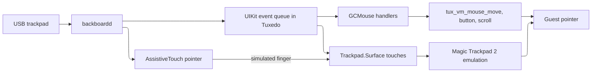

# Mouse capture on iPhone

This file answers one request from the owner: "investigate why iOS doesn't capture mouse input (I have a USB trackpad connected) and whether there is a workaround for Tuxedo to capture it, even if using private APIs."

It was written on 13/11/2026 against commit `8f97ab2` on `linux/integration`. The device is an iPhone 18 Pro with iOS 27.3. The build is signed with a personal team.

This is an investigation and a plan. No code was changed. Nothing was run on the phone or in the simulator.

## Update, 16/11/2026: pointer lock on an iPhone (test P1)

This part is newer than the text below it. The verdict below was written before test P1 was done.

Test P1 was done in the iOS 27.0 simulator (iPhone 18 Pro), with lldb and then with the app's own code. It was not done on a phone.

- The block is in UIKit, in the app's process. `_UIPointerLockStateIsAvailableForScene` returns true only when `_UIDeviceNativeUserInterfaceIdiom()` is 1 (iPad) or 5 (Mac).
- Four places use that test: `-[UIScene pointerLockState]`, `-[UIViewController setNeedsUpdateOfPrefersPointerLocked]`, `-[UIViewController _effectivePointerLockViewController]`, and the settings action (through the getter). Thus `scene.pointerLockState` is nil on an iPhone, and UIKit never calls `prefersPointerLocked`.
- The shell does not have that test. `[[scene _FBSScene] updateUIClientSettingsWithBlock:]` with `setPreferredPointerLockStatus:1` made `settings.pointerLockStatus` change from 0 to 1 (`_UIPointerLockStatusLocked`).
- The shell takes the lock away when the app goes to the background, and gives it back in the foreground.

What the app does now (`PhonePointerLock` in `ios/Tuxedo/Hardware.swift`, iPhone only):

1. It replaces `-[UIScene pointerLockState]` with a getter that has no idiom test. The getter makes the `UIPointerLockState` and registers it as the scene component `_UIPointerLockStateSceneComponentKey`, as UIKit does on an iPad. Then `isLocked` and `UIPointerLockState.didChangeNotification` work.
2. It writes `preferredPointerLockStatus` into the scene's client settings each time `PointerLock.set` runs.
3. It stops the edge push while the pointer is locked.

The log lines are `pointer lock: iPhone path on`, `pointer lock: iPhone asks for locked` and `pointer lock: on`. The switch is Settings, Mouse, "Capture an external mouse" (`tux.mouse.phoneLockOff`).

Not known until a test on the phone:

- Does SpringBoard on a real iPhone grant the lock? The simulator's shell does.
- Does a granted lock hide and hold the pointer that the iPhone draws? The phone log says "AssistiveTouch off", but a pointer was there and it clicked the Home bar. If that pointer is the system's own (PointerUI), the lock is expected to hold it as on an iPad. If it is AssistiveTouch's, the result is not known.
- Do GameController deltas continue with no limit while the pointer is locked? On an iPad they do.

Other private paths that were examined for the Home bar:

| Path | Result |
| --- | --- |
| `BKSMousePointerService` (move or suppress the pointer) | The runtime has the entitlement string `com.apple.backboard.mouse-pointer-service-client`. A personal team can't sign it. |
| `PSPointerClientController` (`persistentlyHidePointerAssertionForReason:`, `autohidePointerForReason:`) | Not tested. It hides the pointer but does not stop its clicks. |
| `UIAccessibility.requestGuidedAccessSession` | Needs a supervised phone with the app in `autonomousSingleAppModePermittedAppIDs`. Guided Access from the side button needs no code. |
| Scene client settings `homeIndicatorAutoHidden`, `screenEdgesDeferringSystemGestures` | Already set through the public API. They did not stop the click. |

## Verdict

iOS does not let an app capture the pointer on an iPhone. Pointer lock is an iPad feature. Tuxedo asks for the lock, and the iPhone ignores the request.

An iPhone also has no pointer of its own. A mouse or trackpad moves a pointer only when AssistiveTouch is on. That pointer belongs to AssistiveTouch, not to Tuxedo. It stops at the screen edge, and Tuxedo cannot hide it.

Tuxedo already receives the buttons through GameController. The log does not show if movement arrives, because Tuxedo does not log movement. That is the first thing to measure.

The best workaround has two parts:

1. Keep the relative path (GameController deltas) and tell the user to set AssistiveTouch correctly.
2. Add an absolute path for when the deltas stop at the screen edge. The system pointer then is the guest pointer, and the edge problem goes away.

No private API is likely to give a true lock with a personal team. Two cheap private tests are worth one hour. They are in the plan.

## What Tuxedo does today

### The path from the device to the guest

### The code

| What | Where |
| --- | --- |
| Request for pointer lock. A block replaces `prefersPointerLocked` on the class of the root view controller. | `ios/Tuxedo/Hardware.swift:121-137` |
| The "refused" hint is for iPad only. The comment says "An iPhone never locks it". | `ios/Tuxedo/Hardware.swift:139-146` |
| `HardwareMouse.start()` attaches to each `GCMouse` and calls `PointerLock.set(true)`. | `ios/Tuxedo/Hardware.swift:167-194` |
| Movement: `mouseMovedHandler` gives raw deltas. Tuxedo scales them and calls `tux_vm_mouse_move`. There is no log line. | `ios/Tuxedo/Hardware.swift:220`, `228-236` |
| Buttons: the first 32 events are logged as `physical mouse button: raw=… guest=…`. | `ios/Tuxedo/Hardware.swift:238-246` |
| Scroll: the first 24 events are logged as `scroll raw: …`. | `ios/Tuxedo/Hardware.swift:251-275` |
| The touch surface ignores `.indirectPointer` touches. It hides the pointer with `UIPointerStyle.hidden()`. | `ios/Tuxedo/Trackpad.swift:50-54`, `80`, `115`, `136` |
| The hint "Make Tuxedo full screen to use the trackpad or mouse" shows only when `PointerLock.refused` is true. | `ios/Tuxedo/SessionView.swift:161-162`, `211-216` |
| The lock is released when the app has its own controls to show. | `ios/Tuxedo/SessionView.swift:245`, `293` |
| `UIApplicationSupportsIndirectInputEvents` is true. There is no `UIRequiresFullScreen` key. Multiple scenes are off. | `ios/Tuxedo/Info.plist:79-91` |
| The entitlements are `get-task-allow` and the increased memory limit. Nothing else. | `ios/Tuxedo/Tuxedo.personal.entitlements` |
| The bridge to the guest. All three calls are relative. | `ios/Tuxedo/Native/tux-vm.c:386-400`, `host/vm.c:898`, `938`, `972` |

The Info.plist is correct for indirect input. A missing key is not the cause.

## Why capture fails on an iPhone

### 1. Pointer lock does not exist on an iPhone

- The SDK header does not mark the API as unavailable on iPhone. `UIViewController.h:703` in the iPhoneOS 27.1 SDK says `API_AVAILABLE(ios(14.0)) API_UNAVAILABLE(watchos, tvos)`. The header also says "This preference may or may not be honored."
- The system makes the decision, not the app. The iOS 27.1 simulator runtime has `-[UIMutableApplicationSceneClientSettings setPreferredPointerLockStatus:]` (the request from the app) and `-[UIApplicationSceneSettings pointerLockStatus]` (the answer from the system).
- Apple Developer Forums thread 677631 reports that the iPhone ignores the request. One post says "The prefersPointerLocked method is not called on iPhone." The same post says "The GCMouse events work on iPhone fine". Apple did not reply.
- Tuxedo commit `dcae4b3` ("an iPhone never locks the pointer") records the same result.
- CloudGear, a game streaming app, tells its users the same: lock and a hidden pointer work on iPad, not on iPhone.

`UIRequiresFullScreen`, Stage Manager and the scene setup are not the cause. An iPhone app is always full screen. Those conditions apply only to iPad.

### 2. The pointer on an iPhone belongs to AssistiveTouch

- An iPhone has no built-in pointer. A mouse or trackpad shows a pointer only when AssistiveTouch is on (Settings, Accessibility, Touch, AssistiveTouch). Apple Support article 111775 and Moonlight issue 735 (iPhone 16 Pro Max, iOS 26.7.2) agree.
- AssistiveTouch has a setting "Perform Touch Gestures". The simulator runtime has the matching preference `AssistiveTouchMouseBehavesLikeFinger`. It is on by default.
- When that setting is on, the pointer is a simulated finger. A click becomes a touch at the pointer position. Tuxedo sees a finger, not a mouse, because the touch type is not `.indirectPointer` (`Trackpad.swift:80`). That finger goes to the Magic Trackpad emulation.
- The same click also arrives as a GameController button. That explains the log lines `physical mouse button: raw=0 guest=0 down/up`.

### 3. What arrives and what does not

| Input | Arrives in Tuxedo? | Evidence |
| --- | --- | --- |
| Buttons | Yes, through `GCMouse`. | The phone log. |
| Movement deltas | Not known. | Tuxedo has no log line for movement. Forum thread 677631 says GCMouse events work on iPhone. CloudGear says apps get pointer input only when AssistiveTouch is on. |
| Deltas when the pointer is at the screen edge | Not known. Probably not. | Moonlight issue 735: "When the pointer reaches the edge of the iPhone screen, movement stops." Moonlight uses GCMouse when one is present. |
| Scroll | Not known. | No `scroll raw:` line was reported from the phone. |
| Simulated finger from AssistiveTouch | Probably yes, when "Perform Touch Gestures" is on. | See part 2. |

### 4. What the user most likely sees

- With AssistiveTouch off: no pointer on the screen. Clicks reach the guest at the place where the guest pointer already is. The guest pointer possibly does not move.
- With AssistiveTouch on: the round AssistiveTouch pointer moves above Tuxedo. Tuxedo cannot hide it. The guest pointer is a second pointer. It follows for a time, then stops when the system pointer reaches the screen edge. A click possibly also acts as a finger on the emulated trackpad.

## Options

### Public APIs

| # | Option | Result | Cost |
| --- | --- | --- | --- |
| 1 | Measure first. Add log lines for movement, hover, touch type and AssistiveTouch state. | Replaces each "not known" above with a fact. | Small |
| 2 | Relative mode with the correct AssistiveTouch settings. AssistiveTouch on, "Perform Touch Gestures" off. GameController deltas drive the guest. | Works inside the screen. Two pointers stay visible. The edge problem stays if deltas stop there. | None in code. A hint in the app. |
| 3 | Absolute mode. Read the pointer position (`UIHoverGestureRecognizer`, or the `.indirectPointer` touch location) and send it to the guest as an absolute position. | The system pointer is the guest pointer. Both stop at the same edge. No lock is necessary. | Medium. The guest needs an absolute device. |
| 4 | Touchscreen mode with the default AssistiveTouch settings. The simulated finger taps the guest at the pointer position. | Clicks and drags work. There is no hover and no right button from the finger. | Small after `LINUX-PLAN-12-touchscreen.md` is built. |
| 5 | External display. The guest is on the monitor. The system pointer stays on the phone screen. | No double pointer on the guest picture. The edge problem possibly stays. | None |
| 6 | Do not let iOS see the device as a pointer. For example, a small computer reads the trackpad and sends the deltas to Tuxedo on the network. | A true capture. | Large, and it needs more hardware. |

Notes on option 3:

- A Linux guest gets an absolute device from the touchscreen plan (`LINUX-PLAN-12-touchscreen.md`). The same virtio-input device can also carry a pointer position, or a second device can be a virtio tablet.
- `UIPointerInteraction` with `.hidden()` is already in `Trackpad.swift:54`. If iOS obeys it on an iPhone with "Perform Touch Gestures" off, then only the guest pointer shows. CloudGear says iOS does not obey it. This must be tested.
- Scroll in this mode comes from `UIPanGestureRecognizer` with `allowedScrollTypesMask = .all`, or from `GCMouseInput.scroll` if it arrives.
- Buttons come from `GCMouse` (already works), or from `UIEvent.buttonMask`.

### Private APIs

A personal team can sign only a small set of entitlements. iOS makes sure that the provisioning profile permits each entitlement in the signature. Thus each option below that needs a private entitlement is not possible on this phone.

| # | Option | Entitlement needed? | Verdict |
| --- | --- | --- | --- |
| P1 | Set the lock request directly. Write `preferredPointerLockStatus` into the scene client settings, to go around a possible iPhone check in UIKit. | No | Worth a test. Thread 677631 says UIKit does not call the getter on iPhone. Thus there is possibly a check on the app side. The shell (SpringBoard) can still refuse. |
| P2 | Read the raw HID events that the app already receives. Use `-[UIApplication _setHIDEventObserver:onQueue:]`, or replace `-[UIApplication _handleHIDEvent:]`. Read the deltas with `IOHIDEventGetFloatValue`. | No | Possible. It is the same stream that GameController reads (`__GCHIDEventUIKitClient`, `_setHIDGameControllerEventObserver:onQueue:`). It will not give more events than GCMouse. It is useful for the diagnosis. |
| P3 | `BKSMousePointerService`. It has `pointerSuppressionAssertionOnDisplay:forReason:withOptionsMask:` (hide the pointer), `setGlobalPointerPosition:` (move the pointer back to the centre) and `requestGlobalMouseEventsForDisplay:targetContextID:`. | Almost certainly yes (a backboardd client entitlement) | Worth one test. Moving the pointer to the centre after each delta is a full fix for the edge problem. Expect a refusal. |
| P4 | `PointerUIServices` (`PSPointerClient…`) to hide or restyle the pointer. | Almost certainly yes | Same as P3. |
| P5 | `IOHIDEventSystemClient` as an event monitor, to read the device below backboardd. | Yes: `com.apple.private.hid.client.event-monitor` (the string is in the runtime) | Not possible. The app sandbox also blocks it. The symbols are in `IOKit.tbd` of the iPhoneOS SDK, but a simple client gets properties only, not events. |
| P6 | Change the AssistiveTouch settings from the app (`AXSettings`, `AssistiveTouchMouseBehavesLikeFinger`). | Yes | Not possible. The preferences are in a system domain. |
| P7 | Talk to the USB device directly: DriverKit, `IOUSBHost`, CoreHID. | Yes | Not possible. DriverKit is for iPad and needs entitlements from Apple. CoreHID is not in the iPhoneOS 27.1 SDK. |
| P8 | Use the attached debugger (`CS_DEBUGGED`). | Not applicable | No gain. The flag relaxes code signature checks for JIT. It does not change the sandbox or the entitlements. System daemons read the entitlements from the signature. |

App Store: P1 to P4 use private selectors or private frameworks. App Review rejects them. That does not matter for a personal build, but these paths must stay behind a build flag.

A jailbreak or a TrollStore-type install can sign any entitlement. Then P3 and P5 work. No such install is known for iOS 27.3.

## Recommended approach

### Step 1: measure (one build, ten minutes on the phone)

Add temporary log lines in `ios/Tuxedo/Hardware.swift` and `ios/Tuxedo/Trackpad.swift`:

1. In `moved(_:_:)`, log the first 40 raw deltas. After that, log a count each second.
2. In `HardwareMouse.start()`, log `UIAccessibility.isAssistiveTouchRunning` and `UIDevice.current.userInterfaceIdiom`.
3. In the block that replaces `prefersPointerLocked`, log the first call. This shows if UIKit asks the question on an iPhone.
4. In `Trackpad.Surface`, log the `type` of each new touch. Add a `UIHoverGestureRecognizer` that logs the first 40 locations.
5. Optional, for P2: log each HID event type from `_setHIDEventObserver:onQueue:`.

Test on the phone, with the trackpad connected and a guest running. Do each row for 20 seconds, then read `tux.log`.

| Run | AssistiveTouch | Perform Touch Gestures | Actions |
| --- | --- | --- | --- |
| A | Off | Not applicable | Move, click, scroll with two fingers. |
| B | On | On (default) | Move, click, drag, scroll. Push the pointer hard into each screen edge for 3 seconds. |
| C | On | Off | Same as B. |

For each run, record:

- Do `moved` deltas arrive?
- Do they continue when the pointer is at the edge?
- Do scroll values arrive?
- What is the touch type of a click (`direct` or `indirectPointer`)?
- Do hover locations arrive?
- Is the system pointer hidden above the guest picture?

### Step 2: use the result

| Result | Action |
| --- | --- |
| Deltas arrive in run C, and continue at the edge. | Relative mode is sufficient. Show a hint on iPhone when a `GCMouse` is connected: "Turn on AssistiveTouch and turn off Perform Touch Gestures". Stop here. |
| Deltas arrive in run C, but stop at the edge. | Build absolute mode (option 3) for Linux first. It uses the device from `LINUX-PLAN-12-touchscreen.md`. Keep relative mode as the fallback, with the hint. |
| No deltas in any run. | Build absolute mode from hover locations, or use touchscreen mode (option 4) with run B settings. |
| A click in run B arrives as a `direct` touch. | In relative mode, drop a touch that starts in the same instant as a `GCMouse` button event. If not, each click is also a finger on the emulated trackpad. |

### Step 3: two private tests, behind a debug flag

Do these only after step 1. Each is one hour or less.

1. P1: with a session running, set `preferredPointerLockStatus` in the scene client settings. Then read `scene.pointerLockState.isLocked` and look for the `pointer lock: on` log line. This can also be done from lldb, with no new build.
2. P3: call `[[BKSMousePointerService sharedInstance] setGlobalPointerPosition:]` with the screen centre. Look at the pointer. Then ask for a suppression assertion. Log each result.

If P1 gives a lock, the problem is solved for personal builds. Put it behind a flag and keep the public path as the default. If P3 works, moving the pointer to the centre after each delta fixes the edge problem in relative mode.

### Step 4: text

- `ios/README.md:59-61` says a trackpad or mouse goes through GameController "with the pointer locked". Add the iPhone limits.
- `README.md:32` names iPad only. Keep that until step 2 is done.

## Risks

- AssistiveTouch is a system setting. Tuxedo cannot change it. The user must set it, and it changes the pointer in all apps.
- Two pointers stay visible in relative mode if iOS does not obey `.hidden()`.
- In absolute mode, the guest pointer acceleration is not used. The pointer speed is the AssistiveTouch tracking speed.
- A game or a 3D program in the guest that needs endless relative movement does not work in absolute mode.
- The system edge gestures (home bar, notification shade) take the pointer near the edges. `persistentSystemOverlays(.hidden)` is set (`SessionView.swift:232`), but AssistiveTouch has its own edge behaviour.
- Private selectors can change name or signature in an iOS update. A call to a selector that is gone causes a crash unless the code checks `responds(to:)` first.
- A private call to a backboardd service without the entitlement can stop the app, not only return an error. Test it in a debug build.

## What is not verified

- No test was run on the iPhone or in the simulator. Each statement about iPhone behaviour comes from headers, runtime strings, the Tuxedo log line, and public reports.
- It is not known if AssistiveTouch was on when the log was made.
- It is not known if `mouseMovedHandler` fires on this phone, in any AssistiveTouch state.
- It is not known if deltas continue at the screen edge. The one public report (Moonlight 735) has no answer from a maintainer.
- It is not known if `UIPointerStyle.hidden()` works on an iPhone with "Perform Touch Gestures" off. CloudGear says it does not.
- It is not known if iOS 27 on iPhone sends hover events and `.indirectPointer` touches to an app. On iPad it does.
- The entitlements for `BKSMousePointerService` and `PointerUIServices` were not identified by name. The strings were read from the iOS 27.1 simulator shared cache, not from a device. The check is in backboardd, which the simulator does not run in the same way.
- The UIKit check that stops the lock request on iPhone was not found by disassembly. Its location (app side or shell side) is a guess from thread 677631.
- The public reports are for iOS 14 to iOS 26. iOS 27.3 can be different.

## Sources

- iPhoneOS 27.1 SDK (Xcode 27.1): `UIKit.framework/Headers/UIViewController.h:695-706`, `UIPointerLockState.h`, `GameController.framework/Headers/GCMouse.h`, `GCMouseInput.h`, `IOKit.framework/IOKit.tbd`.
- iOS 27.1 simulator runtime, `dyld_sim_shared_cache_arm64`: strings for UIKitCore, GameController, BackBoardServices, PointerUIServices and the accessibility settings.
- [Apple Developer Forums 677631, "prefersPointerLocked not work on iPhone"](https://developer.apple.com/forums/thread/677631)
- [Apple Developer Forums 697092, GCMouseInput mouseMovedHandler with more than one mouse](https://developer.apple.com/forums/thread/697092)
- [WWDC20 10617, Bring keyboard and mouse gaming to iPad](https://developer.apple.com/videos/play/wwdc2020/10617/)
- [WWDC20 10094, Handle trackpad and mouse input](https://developer.apple.com/videos/play/wwdc2020/10094/)
- [Moonlight iOS issue 735, USB mouse on iPhone 16 Pro Max](https://github.com/moonlight-stream/moonlight-ios/issues/735)
- [CloudGear, How to Use a Mouse on iPhone](https://www.cloudgear.app/support/troubleshooting/using-a-mouse-on-iphone/)
- [Apple Support 111775, pointer device with AssistiveTouch](https://support.apple.com/en-ug/111775)
- [Apple Community 252001957, "Perform Touch Gestures"](https://discussions.apple.com/thread/252001957)
